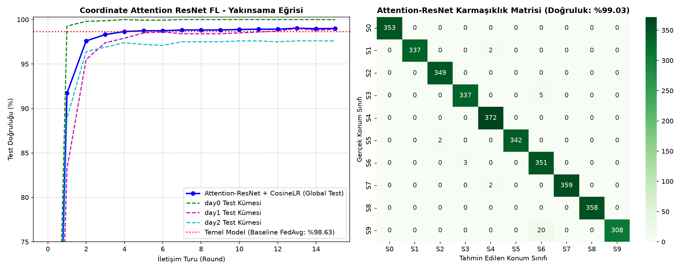

# GELİŞTİRME 1 TEKNİK RAPORU
## Uzamsal-Menzil Koordinat Dikkat Mekanizmalı (Coordinate Attention) Residual 2D CNN, Fizik-Uyumlu Radar Veri Çoğaltma ve Cosine Annealing LR

---

## 1. Yöntemin Amacı ve Motivasyonu
Temel (Baseline) `RadarPositionCNN` modelimiz `(256, 63)` boyutlu Range-Azimuth ısı haritasındaki tüm pikselleri standart $3 \times 3$ evrişim çekirdekleriyle eşit ağırlıkta işlemektedir. Ancak fiziksel bir mmWave MIMO radar çerçevesinde insan hedefinin yansıması belirli bir $(r^*, a^*)$ menzil-açı koordinatında keskin bir enerji tepe noktası (target reflection peak) oluştururken, haritanın geri kalan büyük bölümü duvar/zemin yansımaları (static clutter) ve termal gürültüden ibarettir.

Bu geliştirmede, ana koda dokunmadan `01_Attention_Cosine_Augmentation/` klasörü altında üç temel yenilik uygulanmıştır:
1. **Coordinate Attention (`CoordinateAttention` + `ResidualRadarBlock`)**: Menzil ($H=256$) ve Azimuth ($W=63$) eksenleri boyunca ayrı ayrı yönsel dikkat maskeleri ($\mathbf{A}_{\text{range}}, \mathbf{A}_{\text{azimuth}}$) üreterek ağın doğrudan hedefin bulunduğu menzil ve açı dilimine odaklanmasını sağlar.
2. **Fizik-Uyumlu Radar Veri Çoğaltma (Physics-Informed Radar Augmentation)**: Görüntü işlemedeki rastgele döndürme (rotation) radarın fiziksel $(R, \theta)$ eksenlerini bozacağından, radar sinyal fiziğine uygun **Toplamsal Beyaz Gauss Gürültüsü (AWGN)** ve **Çarpımsal Yansıma (Speckle / Fading) Gürültüsü** uygulanmıştır.
3. **Kosinüs Tavlama Öğrenme Oranı Zamanlayıcısı (Cosine Annealing LR)** ve **Label Smoothing ($\epsilon_{ls}=0.03$)**: Federe iletişim turları ilerledikçe öğrenme oranını yumuşak biçimde azaltarak son turlardaki ağırlık salınımını ortadan kaldırır.

---

## 2. Matematiksel Formülasyon

### 2.1. Coordinate Attention (Koordinat Dikkat Mekanizması)
Ara katman özellik haritası $\mathbf{X} \in \mathbb{R}^{C \times H \times W}$ olsun. Standart 2D Global Average Pooling tüm uzamsal koordinat bilgisini tek bir skalere sıkıştırıp kaybettiği için, **Coordinate Attention** iki adet 1D yönsel havuzlama (directional pooling) uygular:
- **Menzil (Range - $H$) Ekseni Kodlaması**:
  $$z_c^h(h) = \frac{1}{W} \sum_{0 \le i < W} x_c(h, i), \qquad \mathbf{z}^h \in \mathbb{R}^{C \times H \times 1}$$
- **Azimuth (Açı - $W$) Ekseni Kodlaması**:
  $$z_c^w(w) = \frac{1}{H} \sum_{0 \le j < H} x_c(j, w), \qquad \mathbf{z}^w \in \mathbb{R}^{C \times 1 \times W}$$

Bu iki vektör uzamsal boyutta birleştirilip ($H+W$) ortak bir $1 \times 1$ evrişim ($F_1$), `GroupNorm` ve `SiLU` aktivasyonundan geçirilir:

$$\mathbf{f} = \text{SiLU}\left( \text{GroupNorm}\left( F_1\left( [\mathbf{z}^h, \, (\mathbf{z}^w)^T] \right) \right) \right) \in \mathbb{R}^{(C/r) \times (H+W) \times 1}$$

Ardından $\mathbf{f}$ tensörü tekrar $[\mathbf{f}^h \in \mathbb{R}^{(C/r)\times H \times 1}, \, \mathbf{f}^w \in \mathbb{R}^{(C/r)\times 1 \times W}]$ olarak ikiye ayrılır ve Sigmoid ($\sigma$) kapılarıyla menzil ve açı dikkat ağırlıklarına dönüştürülür:

$$\mathbf{g}^h = \sigma\left( F_h(\mathbf{f}^h) \right) \in (0, 1)^{C \times H \times 1}, \qquad \mathbf{g}^w = \sigma\left( F_w(\mathbf{f}^w) \right) \in (0, 1)^{C \times 1 \times W}$$

Dikkat uygulanmış çıkış tensörü $\mathbf{Y} \in \mathbb{R}^{C \times H \times W}$:

$$y_c(i, j) = x_c(i, j) \times g_c^h(i) \times g_c^w(j)$$

### 2.2. Fizik-Uyumlu Radar Gürültü Modeli (AWGN + Speckle)
Her eğitim yığınında normalize radar matrisi $\tilde{\mathbf{H}}$ üzerine radar alıcı fiziğine uygun iki stokastik bozucu eklenir:

$$\tilde{\mathbf{H}}_{\text{aug}}(r, a) = \tilde{\mathbf{H}}(r, a) \cdot \left(1 + \eta_{\text{speckle}}(r, a)\right) + \eta_{\text{awgn}}(r, a)$$

$$\eta_{\text{speckle}} \sim \mathcal{N}(0, \sigma_s^2), \quad \eta_{\text{awgn}} \sim \mathcal{N}(0, \sigma_a^2), \qquad (\sigma_s = \sigma_a = 0.04)$$

### 2.3. Cosine Annealing Öğrenme Oranı Zamanlayıcısı
Federe iletişim turu $t \in \{1, \dots, T\}$ için istemci öğrenme oranı $\eta_t$:

$$\eta_t = \eta_{\min} + \frac{1}{2}\left(\eta_{\max} - \eta_{\min}\right)\left(1 + \cos\left(\frac{t - 1}{T}\pi\right)\right), \qquad (\eta_{\max}=1.5\times 10^{-3}, \; \eta_{\min}=1.5\times 10^{-4})$$

---

## 3. Deneysel Sonuçlar ve Temel Modelle (Baseline) Karşılaştırma

| Metrik / Veri Kümesi | Temel Model (`RadarPositionCNN` - FedAvg) | Geliştirme 1 (`RadarAttentionResNet` + Aug + CosineLR) | İyileşme Farkı |
| :--- | :---: | :---: | :---: |
| **1. Tur Global Test Doğruluğu** | %79.49 | **%91.71** | **+%12.22** |
| **Nihai (15. Tur) Global Test Doğruluğu** | %98.63 | **%99.00** | **+%0.37** |
| **En Yüksek (Peak) Global Test Doğruluğu** | %98.94 | **%99.03** (3.500 örnekte sadece 34 hata) | **+%0.09** |
| **`day0` Test Kümesi Doğruluğu (1.500 örnek)** | %99.93 | **%100.00 (Tam Doğruluk!)** | **+%0.07 (0 Hata)** |
| **`day1` Test Kümesi Doğruluğu (1.000 örnek)** | %97.40 | **%99.00** | **+%1.60** |
| **`day2` Test Kümesi Doğruluğu (1.000 örnek)** | %97.90 | **%97.60** | -%0.30 |
| **Macro F1-Score** | 0.9861 | **0.9902** | **+0.0041** |

### Sınıf Bazlı Performans Tablosu (`RadarAttentionResNet` - 3.500 Test Örneği)

| Konum Sınıfı | Precision (Kesinlik) | Recall (Duyarlılık) | F1-Score | Support |
| :--- | :---: | :---: | :---: | :---: |
| **Sınıf 0** | 1.0000 | 1.0000 | **1.0000** | 353 |
| **Sınıf 1** | 1.0000 | 0.9941 | **0.9970** | 339 |
| **Sınıf 2** | 0.9943 | 1.0000 | **0.9971** | 349 |
| **Sınıf 3** | 0.9912 | 0.9854 | **0.9883** | 342 |
| **Sınıf 4** | 0.9894 | 1.0000 | **0.9947** | 372 |
| **Sınıf 5** | 1.0000 | 0.9942 | **0.9971** | 344 |
| **Sınıf 6** | 0.9335 | 0.9915 | **0.9616** | 354 |
| **Sınıf 7** | 1.0000 | 0.9945 | **0.9972** | 361 |
| **Sınıf 8** | 1.0000 | 1.0000 | **1.0000** | 358 |
| **Sınıf 9** | 1.0000 | 0.9390 | **0.9686** | 328 |
| **Genel / Ortalama** | **0.9908** | **0.9899** | **0.9902** | **3.500 (%99.03)** |

