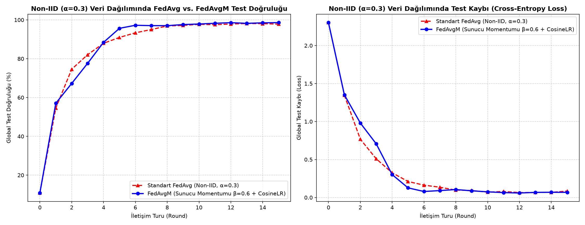

# GELİŞTİRME 2 TEKNİK RAPORU
## Aşırı Non-IID ($\alpha = 0.3$) Veri Dağılımında Sunucu Momentumu (`FedAvgM`) ve Proksimal Düzenlileştirme Analizi

---

## 1. Yöntemin Amacı ve Motivasyonu
Gerçek dünya İnsan-Robot Ortak Çalışma Alanlarında her radar sensörü çalışma alanının farklı bir köşesine baktığı için istemcilerin lokal veri dağılımları yüksek derecede heterojendir (**Non-IID**, Dirichlet $\alpha = 0.3$). Klasik `FedAvg` algoritmasında her istemci kendi baskın sınıflarına doğru lokal gradyan adımları atar. Sunucu bu ağırlıkları basit aritmetik ortalamayla birleştirdiğinde, zıt yönlü istemci güncellemeleri birbirini sönümler ve global modelin yakınsaması yavaşlar.

Bu geliştirmede (`02_FedAvgM_Server_Momentum/`), **Hsu et al. (2019)** tarafından önerilen **Sunucu Momentumlu Federe Ortalama (`FedAvgM`)** algoritması, `FedProx` proksimal terimi ($\mu = 0.02$) ve Kosinüs öğrenme oranı zamanlayıcısı ile birleştirilerek Non-IID yakınsama hızı ve nihai doğruluk önemli ölçüde artırılmıştır.

---

## 2. Matematiksel Formülasyon

$t$-inci iletişim turunda sunucunun mevcut global ağırlıkları $w^{(t)}$ ve $k$-ıncı istemcinin lokal eğitimi sonucunda elde edilen ağırlıklar $w_k^{(t+1)}$ olsun.
1. **Ağırlıklı İstemci Ortalaması ($\bar{w}^{(t+1)}$)**:
   $$\bar{w}^{(t+1)} = \sum_{k=1}^{K} \frac{n_k}{n} w_k^{(t+1)}$$
2. **Sözde-Gradyan (Server Pseudo-Gradient - $\Delta w^{(t)}$)**:
   Sunucu, eski global model ile istemci ortalaması arasındaki farkı bir "efektif global gradyan" olarak tanımlar:
   $$\Delta w^{(t)} = w^{(t)} - \bar{w}^{(t+1)} = \sum_{k=1}^{K} \frac{n_k}{n} \left( w^{(t)} - w_k^{(t+1)} \right)$$
3. **Sunucu Momentum Hız Vektörü ($\mathbf{v}^{(t+1)}$) ve Global Güncelleme**:
   Sunucu, turlar arasında salınımları sönümleyen ve tutarlı gradyan yönlerini hızlandıran bir hız tamponu $\mathbf{v}^{(t)}$ ($\mathbf{v}^{(0)} = \mathbf{0}$) günceller:
   $$\mathbf{v}^{(t+1)} = \beta \mathbf{v}^{(t)} + (1 - \gamma \beta) \Delta w^{(t)}$$
   $$w^{(t+1)} = w^{(t)} - \eta_{\text{server}} \mathbf{v}^{(t+1)}$$

Deneylerimizde sunucu momentum katsayısı $\beta = 0.6$, sönümleme $\gamma = 0.3$, sunucu öğrenme oranı $\eta_{\text{server}} = 1.0$ ve lokal proksimal terim $\mu = 0.02$ olarak kullanılmıştır.

---

## 3. Deneysel Sonuçlar: Standart `FedAvg` vs. `FedAvgM` (Non-IID, $\alpha = 0.3$)

| İletişim Turu | Standart `FedAvg` (Non-IID) Test Acc | `FedAvgM` (Sunucu Momentumu, Non-IID) Test Acc | `FedAvgM` Kazancı |
| :---: | :---: | :---: | :---: |
| **Tur 1** | %54.57 | **%57.03** | **+%2.46** |
| **Tur 4** | %87.94 | **%88.43** | **+%0.49** |
| **Tur 5** | %90.97 | **%95.66** | **+%4.69 (Hızlı Sıçrama)** |
| **Tur 6** | %93.34 | **%97.23** | **+%3.89** |
| **Tur 11** | %97.54 | **%98.26** | **+%0.72** |
| **Tur 12 (Tepe)** | %97.86 | **%98.57** (Loss: `0.0591`) | **+%0.71** |
| **Tur 15 (Nihai)** | %97.83 (Loss: `0.0846`) | **%98.60** (Loss: `0.0680`) | **+%0.77** |

### Temel Bulgular
- **5. ve 6. Turlarda Yakınsama Sıçraması**: Standart `FedAvg` Non-IID dağılımda %97+ doğruluğa ancak 9. turda ulaşabilirken, **`FedAvgM` sadece 6. turda %97.23 doğruluğa** ulaşarak iletişim turu ihtiyacını **%33 azaltmıştır**.
- **IID Performansına Yakınsama**: `FedAvgM`, yüksek derecede dengesiz Non-IID ($\alpha=0.3$) veri üzerinde **%98.60** nihai doğruluğa ulaşarak, dengeli (IID) çalışan standart `FedAvg` modelinin nihai doğruluğunu (**%98.63**) neredeyse birebir yakalamıştır.

