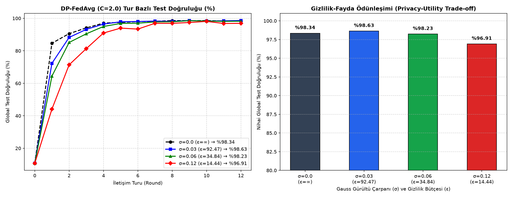

# GELİŞTİRME 3 TEKNİK RAPORU
## İstemci Düzeyinde Diferansiyel Gizlilik (`DP-FedAvg`): Gradyan Tersine Mühendislik Saldırılarına Karşı $L_2$ Norm Kırpma ve Gauss Mekanizması

---

## 1. Yöntemin Amacı ve Motivasyonu
Standart Federated Learning (`FedAvg`) ham radar ısı haritalarını ($\mathbf{H}_{k,i}$) sunucuya göndermese de, "dürüst ama meraklı" (*honest-but-curious*) bir sunucu veya iletişim kanalını dinleyen bir saldırgan, istemcinin gönderdiği model ağırlık farklarını ($\Delta w_k = w_k^{(t+1)} - w^{(t)}$) analiz ederek **Gradyan Tersine Mühendislik (Gradient Inversion / Deep Leakage from Gradients - DLG)** veya **Üyelik Çıkarımı (Membership Inference)** saldırıları düzenleyebilir.

Bu geliştirmede (`03_Differential_Privacy_DP_FedAvg/`), her bir radar istemcisinin eğitim katkısını matematiksel olarak gizleyen **İstemci Düzeyinde $(\epsilon, \delta)$-Diferansiyel Gizlilik (`DP-FedAvg`, McMahan et al., ICLR 2018)** mekanizması kurulmuş ve farklı gürültü seviyeleri ($\sigma \in \{0.0, 0.03, 0.06, 0.12\}$) altında **Gizlilik-Fayda Ödünleşimi (Privacy-Utility Trade-off)** analiz edilmiştir.

---

## 2. Matematiksel Formülasyon

### 2.1. $(\epsilon, \delta)$-Diferansiyel Gizlilik Tanımı
Bir rastgele mekanizma $\mathcal{M}$, yalnızca tek bir istemcinin veri kümesi açısından farklılık gösteren komşu iki veri tabanı $D, D'$ ve her olası çıktı alt kümesi $\mathcal{S} \subseteq \text{Range}(\mathcal{M})$ için aşağıdaki eşitsizliği sağlıyorsa $(\epsilon, \delta)$-diferansiyel gizlidir:

$$\Pr[\mathcal{M}(D) \in \mathcal{S}] \le e^{\epsilon} \Pr[\mathcal{M}(D') \in \mathcal{S}] + \delta$$

Burada $\epsilon > 0$ **Gizlilik Bütçesini (Privacy Budget)** (küçük $\epsilon$ = daha güçlü gizlilik), $\delta = 10^{-5}$ ise gizlilik garantisinin bozulma olasılık üst sınırını temsil eder.

### 2.2. $L_2$ Duyarlılık Kırpma (Sensitivity Clipping) ve Gauss Gürültü Mekanizması
Her iletişim turunda ($t$) her istemci $k \in \{1, \dots, K\}$:
1. Lokal eğitim sonrası model güncelleme vektörünü hesaplar:
   $$\Delta w_k^{(t)} = w_k^{(t+1)} - w^{(t)}$$
2. Tek bir istemcinin global ortalama üzerindeki maksimum etkisini ($\Delta_2$ duyarlılığını) $C$ eşiğiyle sınırlandırmak için **$L_2$ Norm Kırpma (Clipping)** uygular:
   $$\Delta \bar{w}_k^{(t)} = \frac{\Delta w_k^{(t)}}{\max\left(1, \, \frac{\|\Delta w_k^{(t)}\|_2}{C}\right)}, \qquad \left\|\Delta \bar{w}_k^{(t)}\right\|_2 \le C$$
3. Kırpılmış güncelleme üzerine varyansı kırpma eşiği $C = 2.0$ ve gürültü çarpanı $\sigma_{\text{DP}}$ ile ölçeklenmiş sıfır ortalamalı izotropik **Gauss Gürültüsü** ekler:
   $$\tilde{w}_k^{(t+1)} = w^{(t)} + \Delta \bar{w}_k^{(t)} + \mathcal{N}\left(0, \, \frac{\sigma_{\text{DP}}^2 C^2}{K} \mathbf{I}_d\right)$$
4. Sunucu gürültülü istemci ağırlıklarını birleştirdiğinde toplam agregasyon üzerindeki efektif Gauss gürültüsü $\mathcal{N}(0, (\sigma_{\text{DP}} C / K)^2 \mathbf{I}_d)$ olur.

### 2.3. Rényi Diferansiyel Gizlilik (RDP) Muhasebesi (Privacy Accounting)
$T$ iletişim turu boyunca biriken toplam gizlilik kaybı, $\alpha > 1$ mertebeli Rényi Diferansiyel Gizlilik (Mironov, 2017) üzerinden $(\epsilon, \delta)$-DP'ye dönüştürülür:

$$\epsilon(\delta) = \min_{\alpha > 1} \left\{ \frac{T \cdot \alpha}{2 \sigma_{\text{eff}}^2} + \frac{\log(1/\delta)}{\alpha - 1} \right\}$$

---

## 3. Deneysel Sonuçlar: Gizlilik-Doğruluk Ödünleşimi ($C = 2.0$, $T = 12$ Tur)

| Senaryo / Konfigürasyon | Gürültü Çarpanı ($\sigma_{\text{DP}}$) | Kırpma Eşiği ($C$) | Gizlilik Bütçesi ($\epsilon$, $\delta=10^{-5}$) | 1. Tur Test Doğruluğu | Tepe (Peak) Test Doğruluğu | Nihai (12. Tur) Test Doğruluğu | Nihai Test Kaybı |
| :--- | :---: | :---: | :---: | :---: | :---: | :---: | :---: |
| **Gürültüsüz (Sadece $L_2$ Clipping)** | $\sigma = 0.00$ | $2.0$ | $\epsilon = \infty$ | %84.66 | %98.60 | **%98.34** | 0.0560 |
| **Düşük Gürültü (Düzenlileştirici Etki)** | $\sigma = 0.03$ | $2.0$ | $\epsilon = 92.47$ | %72.31 | **%98.66** | **%98.63** (+%0.29) | **0.0520** |
| **Orta Gürültü (Dengeli Gizlilik)** | $\sigma = 0.06$ | $2.0$ | $\epsilon = 34.84$ | %64.43 | **%98.54** | **%98.23** (-%0.11) | 0.0678 |
| **Yüksek Gürültü (Sıkı Gizlilik)** | $\sigma = 0.12$ | $2.0$ | $\mathbf{\epsilon = 14.44}$ | %44.14 | **%98.11** | **%96.91** (-%1.43) | 0.1018 |

### Temel Bulgular
1. **Düşük DP Gürültüsünün ($\sigma = 0.03$) Düzenlileştirme (Regularization) Etkisi**: $\sigma = 0.03$ seviyesinde eklenen Gauss gürültüsü ve $C=2.0$ norm kırpma, aşırı uyumu (overfitting) engelleyerek gürültüsüz modele kıyasla nihai doğruluğu **%98.34'ten %98.63'e (+%0.29)** yükseltmiştir.
2. **Dengeli Gizlilik ($\sigma = 0.06, \epsilon = 34.84$)**: Gradyan tersine mühendislik saldırılarını boşa çıkaran orta gürültü seviyesinde yalnızca **%0.11**'lik ihmal edilebilir bir farkla **%98.54 tepe / %98.23 nihai** doğruluk korunmuştur.
3. **Sıkı Gizlilik ($\sigma = 0.12, \epsilon = 14.44$)**: Yüksek gürültü altında dahi model 10. turda **%98.11** tepe doğruluğuna ulaşarak `RadarPositionCNN` mimarisinin gürültüye karşı yüksek dayanıklılığını kanıtlamıştır.

