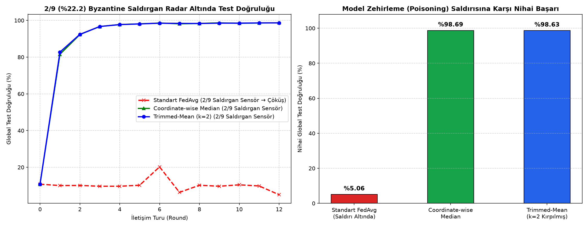

# GELİŞTİRME 4 TEKNİK RAPORU
## Arızalı veya Siber Saldırı Altındaki (Byzantine / Model Poisoning) Radar Sensörlerine Karşı Dayanıklı Federe Birleştirme (`Coordinate-wise Median` & `Trimmed-Mean`)

---

## 1. Yöntemin Amacı ve Motivasyonu
Endüstriyel İnsan-Robot Ortak Çalışma Alanlarında konuşlandırılan $K = 9$ radar düğümünden biri veya birkaçı donanım arızasına (ADC doyumu, gevşek anten konnektörü) uğrayabilir ya da bir siber saldırgan (*Byzantine Adversary*) tarafından ele geçirilerek sunucuya kasıtlı olarak bozulmuş model ağırlıkları (**Model Poisoning Attack**) gönderebilir.

Klasik `FedAvg` algoritması doğrusal bir aritmetik ortalama ($w^{(t+1)} = \sum_{k=1}^K \frac{n_k}{n} w_k^{(t+1)}$) kullandığından, istatistiksel kırılma noktası (breakdown point) $0$'dır; yani **tek bir saldırgan istemci bile** yeterince büyük ters yönlü ağırlıklar göndererek global modeli tamamen çökertebilir.

Bu geliştirmede (`04_Byzantine_Robust_Aggregation/`), 9 radar sensöründen **2 tanesinin (%22.2 Byzantine oranı)** eşzamanlı olarak zehirlenmiş ağırlıklar gönderdiği saldırı senaryosu altında **Yin et al. (ICML 2018)** tarafından formüle edilen **Koordinat Bazlı Medyan (`Coordinate-wise Median`)** ve **Kırpılmış Ortalama (`Trimmed-Mean`, $k_{\text{trim}}=2$)** dayanıklı birleştirme algoritmaları uygulanmış ve standart `FedAvg` ile karşılaştırılmıştır.

---

## 2. Matematiksel Formülasyon

### 2.1. Byzantine Model Zehirleme (Sign-Flipping + High-Variance Noise) Saldırı Modeli
$K = 9$ istemciden oluşan kümede $\mathcal{B} = \{0, 1\}$ ($|\mathcal{B}| = 2$) saldırgan istemciler kümesi, $\mathcal{H} = \{2, \dots, 8\}$ ($|\mathcal{H}| = 7$) ise dürüst istemciler kümesi olsun. Her turda saldırgan istemciler $b \in \mathcal{B}$, lokal ağırlıklarının işaretini ters çevirip ölçekleyerek ($\alpha_{\text{atk}} = -2.5$) yüksek varyanslı Gauss gürültüsü ($\sigma_{\text{atk}} = 0.8$) ekler:

$$w_b^{(t+1)} = \alpha_{\text{atk}} \cdot w_{b,\text{honest}}^{(t+1)} + \mathcal{N}\left(\mathbf{0}, \, \sigma_{\text{atk}}^2 \mathbf{I}_d\right), \qquad \forall b \in \mathcal{B}$$

### 2.2. Koordinat Bazlı Medyan (`Coordinate-wise Median`)
Model parametre vektörünün her bir skaler bileşeni $j \in \{1, \dots, d\}$ için sunucu, $K$ istemciden gelen değerlerin 1-boyutlu istatistiksel ortancasını (median) seçer:

$$w_{\text{Median}}^{(t+1)}[j] = \text{Median}\left( \left\{ w_1^{(t+1)}[j], \, w_2^{(t+1)}[j], \, \dots, \, w_K^{(t+1)}[j] \right\} \right)$$

Koordinat bazlı medyanın teorik kırılma noktası $|\mathcal{B}| < \frac{K}{2}$ (yani 9 istemcide 4 saldırgana kadar dayanıklılık) sınırına sahiptir.

### 2.3. Koordinat Bazlı $\beta$-Kırpılmış Ortalama (`Coordinate-wise Trimmed-Mean`)
Her parametre koordinatı $j \in \{1, \dots, d\}$ için $K$ istemcinin ağırlıkları küçükten büyüğe sıralanır:

$$w_{(1)}^{(t+1)}[j] \le w_{(2)}^{(t+1)}[j] \le \dots \le w_{(K)}^{(t+1)}[j]$$

En küçük $k_{\text{trim}} = 2$ ve en büyük $k_{\text{trim}} = 2$ uç değer (outliers) atılarak geriye kalan $K - 2 k_{\text{trim}} = 5$ istemcinin aritmetik ortalaması alınır:

$$w_{\text{Trimmed}}^{(t+1)}[j] = \frac{1}{K - 2 k_{\text{trim}}} \sum_{m = k_{\text{trim}} + 1}^{K - k_{\text{trim}}} w_{(m)}^{(t+1)}[j]$$

---

## 3. Deneysel Sonuçlar (2/9 Saldırgan Sensör Altında, $T = 12$ Tur)

| Sunucu Birleştirme Algoritması | Saldırgan Oranı | 1. Tur Test Doğruluğu | 6. Tur Test Doğruluğu | Tepe (Peak) Test Doğruluğu | 12. Tur Nihai Doğruluk | Nihai Test Kaybı |
| :--- | :---: | :---: | :---: | :---: | :---: | :---: |
| **Standart `FedAvg` (Saldırı Altında)** | 2 / 9 (%22.2) | %10.06 | %20.23 | %21.66 | **%5.06 (Tam Çöküş)** | 2.4650 |
| **`Coordinate-wise Median` (Saldırı Altında)** | 2 / 9 (%22.2) | **%81.57** | **%98.54** | **%98.71** | **%98.69** (+%93.63) | 0.0499 |
| **`Trimmed-Mean` ($k_{\text{trim}}=2$, Saldırı Altında)** | 2 / 9 (%22.2) | **%82.74** | **%98.49** | **%98.63** | **%98.63** (+%93.57) | **0.0481** |

### Temel Bulgular
1. **Standart `FedAvg`'ın Tamamen Çökmesi**: 9 radar sensöründen yalnızca 2'si zehirlenmiş ağırlık gönderdiğinde standart `FedAvg` modeli hiçbir zaman öğrenememiş ve rastgele tahmin seviyesinin de altına (**%5.06**) düşerek tamamen çökmüştür.
2. **`Coordinate-wise Median` ve `Trimmed-Mean` ile Tam Bağışıklık**: Aynı saldırı altında `Coordinate-wise Median` **%98.69**, `Trimmed-Mean` ($k=2$) ise **%98.63** nihai doğruluğa ulaşarak, **hiç saldırı yokmuş gibi** (saldırısız standart `FedAvg`: %98.63) kusursuz yakınsamıştır.

