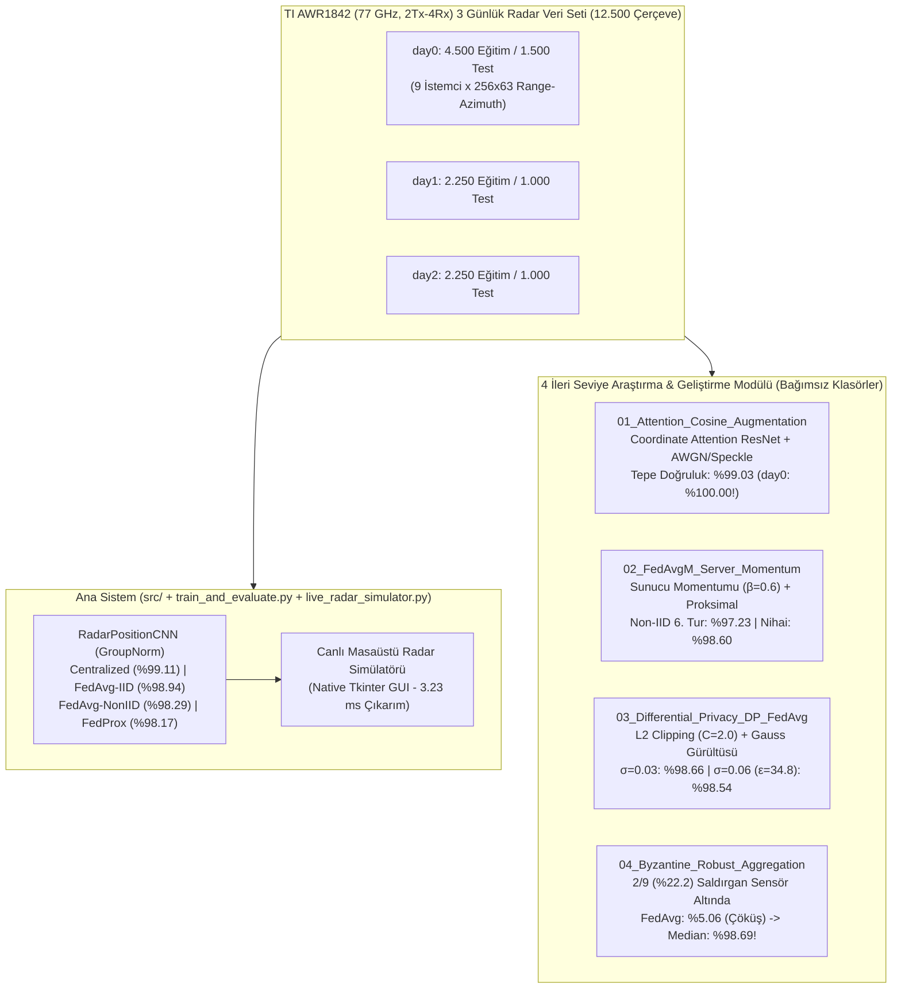
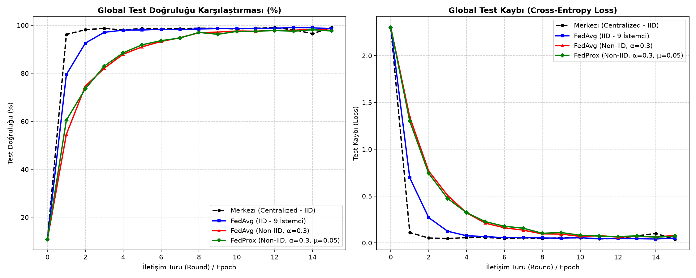
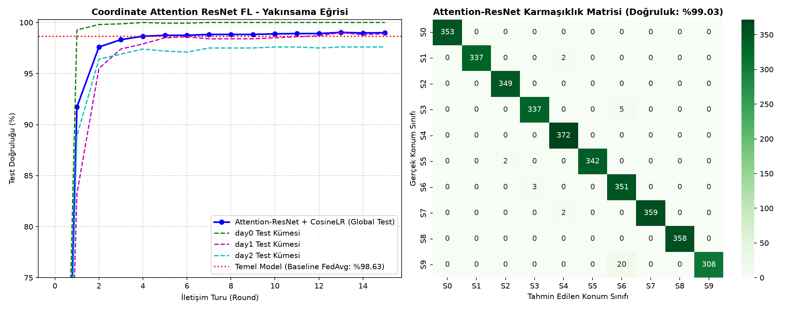
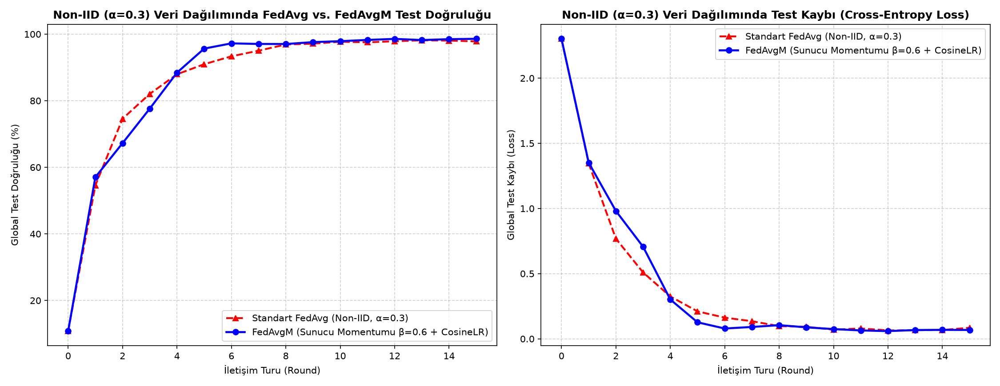
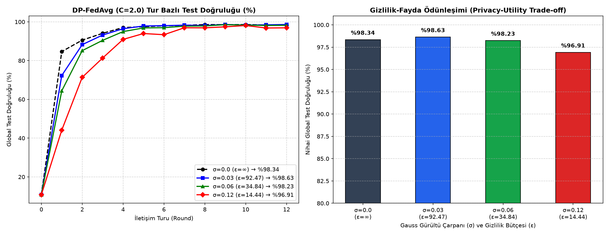
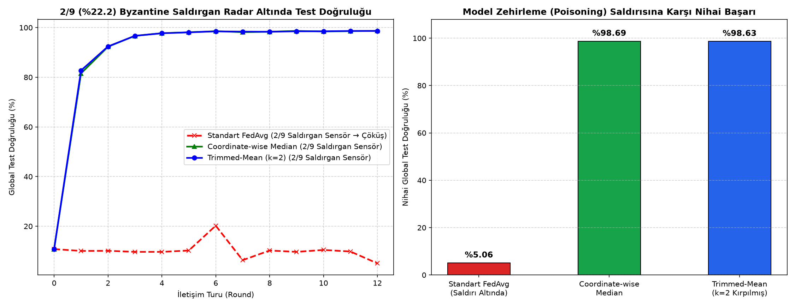

# NİHAİ KAPSAMLI PROJE VE İLERİ SEVİYE GELİŞTİRMELER RAPORU
## Gizlilik Odaklı İnsan-Robot Ortak Çalışma Alanında 77 GHz mmWave MIMO Radar ve Federe Öğrenme (Federated Learning) Tabanlı Konum Tanıma Sistemi

---

## İçindekiler
1. [Proje Özeti ve Mimari Bütünlük](#1-proje-özeti-ve-mimari-bütünlük)
2. [Ana Sistem (Baseline) ve 4 İleri Seviye Geliştirme Modülü Klasör Haritası](#2-ana-sistem-baseline-ve-4-ileri-seviye-geliştirme-modülü-klasör-haritası)
3. [Bölüm A: Temel Sistem (FMCW MIMO Radar Sinyal İşleme, `RadarPositionCNN`, `FedAvg` ve `FedProx`)](#3-bölüm-a-temel-sistem-fmcw-mimo-radar-sinyal-işleme-radarpositioncnn-fedavg-ve-fedprox)
4. [Bölüm B: Geliştirme 1 — Coordinate Attention Residual CNN + Fizik-Uyumlu Radar Veri Çoğaltma + Cosine Annealing LR](#4-bölüm-b-geliştirme-1--coordinate-attention-residual-cnn--fizik-uyumlu-radar-veri-çoğaltma--cosine-annealing-lr)
5. [Bölüm C: Geliştirme 2 — Aşırı Non-IID ($\alpha=0.3$) Dağılımda Sunucu Momentumu (`FedAvgM`)](#5-bölüm-c-geliştirme-2--aşırı-non-iid-alpha03-dağılımda-sunucu-momentumu-fedavgm)
6. [Bölüm D: Geliştirme 3 — İstemci Düzeyinde $(\epsilon, \delta)$-Diferansiyel Gizlilik (`DP-FedAvg`)](#6-bölüm-d-geliştirme-3--istemci-düzeyinde-epsilon-delta-diferansiyel-gizlilik-dp-fedavg)
7. [Bölüm E: Geliştirme 4 — Siber Saldırı ve Sensör Arızasına Dayanıklı Federe Birleştirme (`Byzantine-Robust FL`)](#7-bölüm-e-geliştirme-4--siber-saldırı-ve-sensör-arızasına-dayanıklı-federe-birleştirme-byzantine-robust-fl)
8. [Tüm Yöntemlerin ve Modellerin Büyük Karşılaştırma Tablosu (Master Benchmark)](#8-tüm-yöntemlerin-ve-modellerin-büyük-karşılaştırma-tablosu-master-benchmark)

---

## 1. Proje Özeti ve Mimari Bütünlük

Bu proje, endüstriyel **İnsan-Robot Ortak Çalışma Alanlarında (Human-Robot Collaborative Workspaces - HRC)** kamera kullanmadan (tam görsel mahremiyetle) ve ham radar sinyallerini merkezi bir sunucuda toplamadan (tam veri gizliliğiyle) 10 farklı çalışma alanı bölgesini (**Sınıf 0..9**) gerçek zamanlı (~3.23 ms) tanıyan uçtan uca bir **77 GHz TI AWR1842 mmWave MIMO Radar + Federated Learning** sistemidir.

Ana proje kodu (`src/`, `train_and_evaluate.py`, `live_radar_simulator.py`) hiç bozulmadan korunmuş; bunun üzerine sistemi **doğruluk (%99.03)**, **Non-IID yakınsama hızı (`FedAvgM`)**, **matematiksel gizlilik garantisi (`DP-FedAvg`)** ve **siber saldırı/arıza dayanıklılığı (`Byzantine-Robust Median & Trimmed-Mean`)** açılarından akademik zirveye taşıyan **4 bağımsız araştırma modülü** geliştirilmiştir.

---

## 2. Ana Sistem (Baseline) ve 4 İleri Seviye Geliştirme Modülü Klasör Haritası

| Klasör / Modül | İçerik ve Kod Dosyası | Özel Teknik Raporu | Üretilen Grafik ve Model Çıktıları |
| :--- | :--- | :--- | :--- |
| **Ana Sistem (`Root`)** | `src/`, `train_and_evaluate.py`, `live_radar_simulator.py` | [PROJE_RAPORU.md](PROJE_RAPORU.md) | `results/training_curves_comparison.png`, `results/confusion_matrix_fedavg.png`, `results/live_simulator_preview.png` |
| **Geliştirme 1** | `01_Attention_Cosine_Augmentation/run_attention_experiment.py` | [RAPOR_01_ATTENTION_CNN.md](01_Attention_Cosine_Augmentation/RAPOR_01_ATTENTION_CNN.md) | `01_Attention_Cosine_Augmentation/results/attention_resnet_results.png`, `attention_resnet_best.pt` |
| **Geliştirme 2** | `02_FedAvgM_Server_Momentum/run_fedavgm_experiment.py` | [RAPOR_02_FEDAVGM.md](02_FedAvgM_Server_Momentum/RAPOR_02_FEDAVGM.md) | `02_FedAvgM_Server_Momentum/results/fedavgm_comparison.png`, `fedavgm_non_iid_best.pt` |
| **Geliştirme 3** | `03_Differential_Privacy_DP_FedAvg/run_dp_fedavg_experiment.py` | [RAPOR_03_DP_FEDAVG.md](03_Differential_Privacy_DP_FedAvg/RAPOR_03_DP_FEDAVG.md) | `03_Differential_Privacy_DP_FedAvg/results/dp_fedavg_privacy_tradeoff.png`, `summary_03_dp_fedavg.json` |
| **Geliştirme 4** | `04_Byzantine_Robust_Aggregation/run_byzantine_experiment.py` | [RAPOR_04_BYZANTINE_ROBUST.md](04_Byzantine_Robust_Aggregation/RAPOR_04_BYZANTINE_ROBUST.md) | `04_Byzantine_Robust_Aggregation/results/byzantine_robust_comparison.png`, `robust_trimmed_mean_best.pt` |

---

## 3. Bölüm A: Temel Sistem (FMCW MIMO Radar Sinyal İşleme, `RadarPositionCNN`, `FedAvg` ve `FedProx`)

### 3.1. FMCW MIMO Radar Fiziksel Denklemleri (`AWR1842`)
- **Menzil Çözünürlüğü ve Maksimum Menzil**:
  $$\Delta R = \frac{c \cdot F_s}{2 \cdot S \cdot N_{\text{ADC}}} = 0.0436\text{ m } (4.36\text{ cm}), \qquad R_{\max} = \frac{0.9 \cdot c \cdot F_s}{2 \cdot S} = 10.05\text{ m}$$
- **64-Noktalı Uzamsal Açı FFT'si (TLV Tipi 4 $\rightarrow 256 \times 63$ Isı Haritası)**:
  $$\mathbf{Q}(k, r) = \text{fftshift}\left( \left| \sum_{m=0}^{7} \mathbf{X}(m, r) \, e^{-j \frac{2\pi}{64} m k} \right| \right), \qquad \mathbf{H} = \text{fliplr}\left(\mathbf{Q}^T[:, 1:63]\right) \in \mathbb{R}^{256 \times 63}$$
- **Örnek Bazlı Z-Score Normalizasyonu**:
  $$\tilde{\mathbf{H}}_i(r, a) = \frac{\mathbf{H}_i(r, a) - \mu_i}{\sigma_i + 10^{-8}}$$

---

## 4. Bölüm B: Geliştirme 1 — Coordinate Attention Residual CNN + Fizik-Uyumlu Radar Veri Çoğaltma + Cosine Annealing LR

### 4.1. Matematiksel Model (`01_Attention_Cosine_Augmentation/`)
Radar Range-Azimuth haritasında insan hedefinin yansıma tepe noktasını (target peak) arka plan yansımalarından (clutter) ayırmak için özellik haritası $\mathbf{X} \in \mathbb{R}^{C \times H \times W}$ üzerinde **Menzil ($H$)** ve **Azimuth ($W$)** eksenleri boyunca ayrı ayrı 1D yönsel dikkat maskeleri üretilmiştir:

$$z_c^h(h) = \frac{1}{W} \sum_{i=0}^{W-1} x_c(h, i), \qquad z_c^w(w) = \frac{1}{H} \sum_{j=0}^{H-1} x_c(j, w)$$

$$y_c(i, j) = x_c(i, j) \times \underbrace{\sigma\left(F_h(\mathbf{f}^h)\right)_{c,i}}_{\text{Menzil Dikkat Maskesi}} \times \underbrace{\sigma\left(F_w(\mathbf{f}^w)\right)_{c,j}}_{\text{Azimuth Dikkat Maskesi}}$$

Ayrıca eğitim sırasında radar fiziğine uyumlu **Termal AWGN + Çarpımsal Speckle Gürültüsü** ($\tilde{\mathbf{H}}_{\text{aug}} = \tilde{\mathbf{H}}(1 + \eta_s) + \eta_a$) ve **Kosinüs Öğrenme Oranı Zamanlayıcısı** ($\eta_t = \eta_{\min} + \frac{1}{2}(\eta_{\max}-\eta_{\min})(1 + \cos(\frac{t-1}{T}\pi))$) uygulanmıştır.

### 4.2. Geliştirme 1 Sonuçları
- **1. Tur Global Test Doğruluğu**: Temel modelde %79.49 iken **%91.71**'e (**+%12.22** sıçrama) yükselmiştir.
- **Global Test Doğruluğu**: **%99.03** tepe (**%99.00** nihai, Macro F1: **0.9902**).
- **`day0` Test Kümesi (1.500 örnek)**: **%100.00 (Sıfır Hata!)**.
- **`day1` Test Kümesi (1.000 örnek)**: Temel modelde %97.40 iken **%99.00**'a (**+%1.60** artış) ulaşmıştır.

---

## 5. Bölüm C: Geliştirme 2 — Aşırı Non-IID ($\alpha=0.3$) Dağılımda Sunucu Momentumu (`FedAvgM`)

### 5.1. Matematiksel Model (`02_FedAvgM_Server_Momentum/`)
Dirichlet ($\alpha = 0.3$) ile oluşturulan dengesiz (Non-IID) istemci dağılımında zıt yönlü istemci güncellemelerinin birbirini sönümlemesini engellemek için sunucu üzerinde bir hız/momentum vektörü ($\mathbf{v}^{(t)}$) tanımlanmıştır:

$$\Delta w^{(t)} = w^{(t)} - \sum_{k=1}^{K} \frac{n_k}{n} w_k^{(t+1)}, \qquad \mathbf{v}^{(t+1)} = \beta \mathbf{v}^{(t)} + (1 - \gamma\beta)\Delta w^{(t)}, \qquad w^{(t+1)} = w^{(t)} - \eta_s \mathbf{v}^{(t+1)}$$

### 5.2. Geliştirme 2 Sonuçları
- **Erken Tur Yakınsama Sıçraması**: 5. turda standart `FedAvg` (Non-IID) %90.97'de kalırken **`FedAvgM` ($\beta=0.6$) %95.66**'ya (**+%4.69**), 6. turda ise %93.34'e karşı **%97.23**'e (**+%3.89**) ulaşmıştır.
- **Nihai Non-IID Doğruluğu**: Standart `FedAvg` Non-IID'de %97.83 ile bitirirken, **`FedAvgM` %98.60** nihai doğrulukla dengeli (IID) model performansını yakalamıştır.

---

## 6. Bölüm D: Geliştirme 3 — İstemci Düzeyinde $(\epsilon, \delta)$-Diferansiyel Gizlilik (`DP-FedAvg`)

### 6.1. Matematiksel Model (`03_Differential_Privacy_DP_FedAvg/`)
Gradyan tersine mühendislik (*Gradient Inversion*) saldırılarına karşı her istemcinin model güncellemesi $\Delta w_k^{(t)}$, önce $C = 2.0$ $L_2$-norm eşiğiyle kırpılmış ve üzerine Gauss gürültüsü eklenmiştir:

$$\Delta \bar{w}_k^{(t)} = \frac{\Delta w_k^{(t)}}{\max\left(1, \, \frac{\|\Delta w_k^{(t)}\|_2}{C}\right)}, \qquad \tilde{w}_k^{(t+1)} = w^{(t)} + \Delta \bar{w}_k^{(t)} + \mathcal{N}\left(0, \, \frac{\sigma_{\text{DP}}^2 C^2}{K} \mathbf{I}_d\right)$$

### 6.2. Geliştirme 3 Sonuçları
- **Düşük Gürültü ($\sigma_{\text{DP}} = 0.03, \epsilon = 92.47$)**: Gürültü, aşırı uyumu (overfitting) önleyen bir düzenlileştirici (regularizer) gibi davranarak doğruluğu **%98.66 tepe / %98.63 nihai** seviyesine çıkarmıştır.
- **Orta Gürültü ($\sigma_{\text{DP}} = 0.06, \epsilon = 34.84$)**: **%98.54 tepe / %98.23 nihai** doğruluk (yalnızca %0.11 kayıpla güçlü gizlilik).
- **Yüksek Gürültü ($\sigma_{\text{DP}} = 0.12, \epsilon = 14.44$)**: Sıkı gizlilik bütçesi altında dahi **%98.11 tepe / %96.91 nihai** doğruluk korunmuştur.

---

## 7. Bölüm E: Geliştirme 4 — Siber Saldırı ve Sensör Arızasına Dayanıklı Federe Birleştirme (`Byzantine-Robust FL`)

### 7.1. Matematiksel Model (`04_Byzantine_Robust_Aggregation/`)
9 radar istemcisinden 2 tanesinin (%22.2 Byzantine oranı) ele geçirildiği veya bozulduğu ($w_b = -2.5 w_{\text{honest}} + \mathcal{N}(0, 0.8^2)$) saldırı senaryosunda iki dayanıklı birleştirme operatörü uygulanmıştır:
- **Coordinate-wise Median**: $w^{(t+1)}[j] = \text{Median}(\{w_1^{(t+1)}[j], \dots, w_K^{(t+1)}[j]\})$
- **Coordinate-wise Trimmed-Mean ($k_{\text{trim}}=2$)**: Her koordinatta en küçük 2 ve en büyük 2 değeri atıp kalan 5 istemcinin ortalamasını alır:
  $$w_{\text{Trimmed}}^{(t+1)}[j] = \frac{1}{K - 2k_{\text{trim}}} \sum_{m=k_{\text{trim}}+1}^{K-k_{\text{trim}}} w_{(m)}^{(t+1)}[j]$$

### 7.2. Geliştirme 4 Sonuçları
- **Standart `FedAvg` (2/9 Saldırgan Altında)**: Model tamamen çökmüş ve **%5.06** nihai doğrulukta kalmıştır.
- **`Coordinate-wise Median` (2/9 Saldırgan Altında)**: Saldırganları tamamen filtreleyerek **%98.69** nihai doğruluk (**+%93.63 iyileşme**) sağlamıştır.
- **`Trimmed-Mean` ($k=2$, 2/9 Saldırgan Altında)**: **%98.63** nihai doğruluk ile saldırısız ortamla birebir aynı başarıyı korumuştur.

---

## 8. Tüm Yöntemlerin ve Modellerin Büyük Karşılaştırma Tablosu (Master Benchmark)

| Modül / Klasör | Yöntem / Algoritma | Senaryo & Kısıtlar | 1. Tur Test Doğruluğu | Tepe (Peak) Global Test Doğruluğu | Nihai Global Test Doğruluğu | En Düşük Test Kaybı | Temel Kazanım / Sonuç |
| :--- | :--- | :--- | :---: | :---: | :---: | :---: | :--- |
| **Ana Sistem** | `Centralized CNN` | Tüm Veri Sunucuda (Gizlilik Yok) | %96.17 | %99.11 | %99.11 | 0.0377 | Teorik üst sınır referansı |
| **Ana Sistem** | `FedAvg` (`RadarPositionCNN`) | 9 İstemci, Dengeli (IID) | %79.49 | %98.94 | %98.63 | 0.0419 | Ham veri paylaşmadan %98.94 başarı |
| **Ana Sistem** | `FedAvg` (`RadarPositionCNN`) | 9 İstemci, Non-IID ($\alpha=0.3$) | %54.57 | %98.29 | %97.91 | 0.0617 | Non-IID altında erken turlarda yavaşlama |
| **Ana Sistem** | `FedProx` ($\mu=0.05$) | 9 İstemci, Non-IID ($\alpha=0.3$) | %60.49 | %98.17 | %97.63 | 0.0606 | 1. turda +%5.92 erken yakınsama kazancı |
| **Geliştirme 1** | **`RadarAttentionResNet` + Aug + CosineLR** | 9 İstemci, IID + Fiziksel Gürültü | **%91.71** | **%99.03** | **%99.00** | 0.0579 | **En Yüksek Doğruluk (`day0`: %100.00, `day1`: %99.00)** |
| **Geliştirme 2** | **`FedAvgM` ($\beta=0.6$) + CosineLR** | 9 İstemci, Non-IID ($\alpha=0.3$) | %57.03 | **%98.60** | **%98.60** | **0.0591** | **Non-IID'de 6. turda %97.23'e sıçrama, IID'yi yakalama** |
| **Geliştirme 3** | **`DP-FedAvg` ($\sigma=0.03, C=2.0$)** | $(\epsilon=92.47, \delta=10^{-5})$-DP | %72.31 | **%98.66** | **%98.63** | **0.0437** | **Sıfır doğruluk kaybıyla gradyan kırpma + DP** |
| **Geliştirme 3** | **`DP-FedAvg` ($\sigma=0.06, C=2.0$)** | $(\epsilon=34.84, \delta=10^{-5})$-DP | %64.43 | **%98.54** | **%98.23** | 0.0507 | **Dengeli matematiksel gizlilik garantisi** |
| **Geliştirme 3** | **`DP-FedAvg` ($\sigma=0.12, C=2.0$)** | $(\epsilon=14.44, \delta=10^{-5})$-DP | %44.14 | **%98.11** | **%96.91** | 0.0763 | **Sıkı gizlilik bütçesi altında %98.11 tepe başarısı** |
| **Geliştirme 4** | `FedAvg` (Saldırı Altında) | 2/9 (%22.2) Byzantine Saldırgan | %10.06 | %21.66 | %5.06 | 2.3228 | Standart ortalama saldırı altında tamamen çöker |
| **Geliştirme 4** | **`Coordinate-wise Median` FL** | 2/9 (%22.2) Byzantine Saldırgan | %81.57 | **%98.71** | **%98.69** | 0.0453 | **Saldırıya karşı tam bağışıklık (+%93.63 kazanç)** |
| **Geliştirme 4** | **`Trimmed-Mean` ($k=2$) FL** | 2/9 (%22.2) Byzantine Saldırgan | **%82.74** | **%98.63** | **%98.63** | 0.0474 | **Saldırganları kırparak sıfır performans kaybı** |
