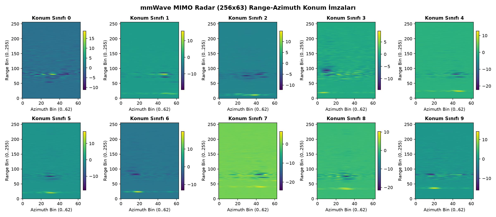
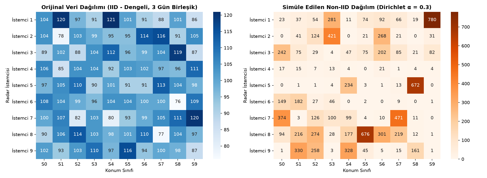
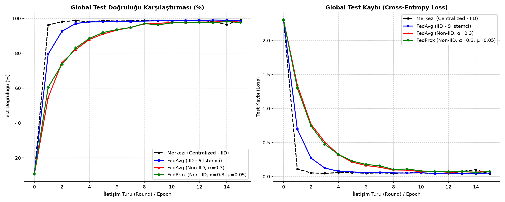
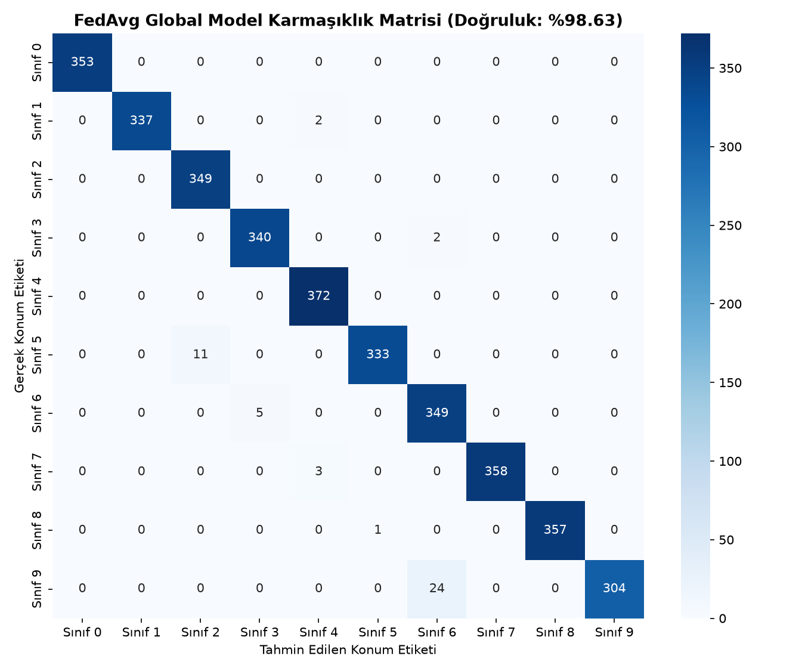
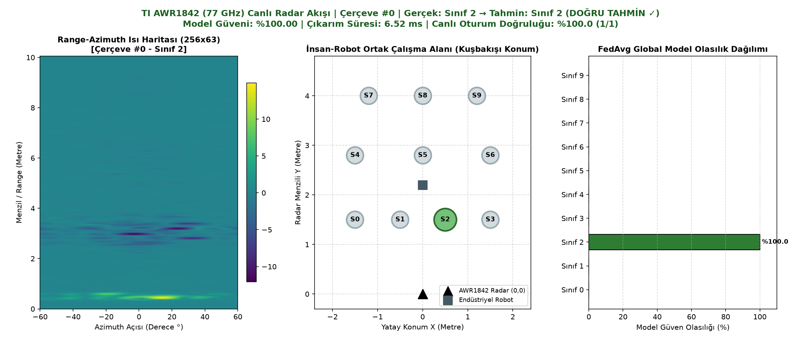

# KAPSAMLI PROJE TEKNİK RAPORU
## Gizlilik Odaklı İnsan-Robot Ortak Çalışma Alanında 77 GHz mmWave MIMO Radar ve Federe Öğrenme (Federated Learning) Tabanlı Konum Tanıma Sistemi

---

## İçindekiler
1. [Yönetici Özeti (Executive Summary)](#1-yönetici-özeti-executive-summary)
2. [Problemin Tanımı, Motivasyon ve Projenin Amacı](#2-problemin-tanımı-motivasyon-ve-projenin-amacı)
3. [mmWave FMCW MIMO Radar Teorisi ve Matematiksel Sinyal İşleme Formülasyonu](#3-mmwave-fmcw-mimo-radar-teorisi-ve-matematiksel-sinyal-işleme-formülasyonu)
4. [Veri Seti Mimarisi, Ön İşleme ve Non-IID (Dirichlet) Dağılım Modellemesi](#4-veri-seti-mimarisi-ön-işleme-ve-non-iid-dirichlet-dağılım-modellemesi)
5. [Derin Öğrenme (`RadarPositionCNN`) ve Normalizasyon Formülasyonu](#5-derin-öğrenme-radarpositioncnn-ve-normalizasyon-formülasyonu)
6. [Federe Öğrenme Algoritmaları (`FedAvg` ve `FedProx`) Matematiksel Analizi](#6-federe-öğrenme-algoritmaları-fedavg-ve-fedprox-matematiksel-analizi)
7. [Deneysel Sonuçlar, Karşılaştırmalar ve Performans Metrikleri](#7-deneysel-sonuçlar-karşılaştırmalar-ve-performans-metrikleri)
8. [Canlı Radar Konum Tanıma Simülatörü ve Gerçek Zamanlı Donanım Köprüsü](#8-canlı-radar-konum-tanıma-simülatörü-ve-gerçek-zamanlı-donanım-köprüsü)
9. [Sonuç ve Gelecek Çalışmalar](#9-sonuç-ve-gelecek-çalışmalar)

---

## 1. Yönetici Özeti (Executive Summary)
Endüstriyel **İnsan-Robot Ortak Çalışma Alanlarında (Human-Robot Collaborative Workspaces - HRC)**, akıllı üretim hatlarında ve sağlık/yaşlı bakım ortamlarında insan konumunun gerçek zamanlı ve yüksek doğrulukla takip edilmesi, çarpışma önleme (iş güvenliği) ve süreç otomasyonu açısından hayati önem taşır. Kamera tabanlı optik sistemler hem görsel mahremiyet ihlallerine yol açmakta hem de karanlık, duman, toz veya parlama koşullarında başarısız olmaktadır. Buna karşın **77 GHz mmWave MIMO Radar** sensörleri optik görüntü kaydetmeden, elektromanyetik dalga yansımalarıyla her türlü ortam koşulunda hassas menzil, açı ve hız ölçümü sağlar.

Ancak çalışma alanına dağıtılmış çok sayıda radar sensöründen gelen yüksek boyutlu ham sinyal matrislerinin merkezi bir sunucuda toplanması; **veri gizliliği riskleri**, **yüksek ağ bant genişliği tüketimi** ve **iletişim gecikmesi** doğurur. Bu projede, **Texas Instruments AWR1842 (77 GHz, 2Tx-4Rx)** mmWave MIMO radarlarından elde edilen `(256, 63)` boyutlu **Range-Azimuth (Menzil-Açı)** ısı haritaları üzerinde, ham verileri hiçbir zaman sensör düğümünden (Raspberry Pi 4 / uç cihazdan) dışarı çıkarmadan eğiten **Federated Learning (`FedAvg` ve `FedProx`)** tabanlı bir derin öğrenme sistemi geliştirilmiştir.

3 farklı günde (`day0`, `day1`, `day2`) 9 radar istemcisinden toplanan toplam **12.500 radar çerçevesi** (9.000 eğitim, 3.500 test) üzerinde gerçekleştirilen kapsamlı deneylerde:
- **Geleneksel Merkezi Eğitim (Centralized Baseline)**: **%99.11** test doğruluğu (Kayıp: `0.0377`),
- **FedAvg (9 İstemci - IID Dağılım)**: **%98.94** tepe (**%98.63** nihai) global test doğruluğu (`day0` üzerinde **%99.93**, `day1` üzerinde **%97.40**, `day2` üzerinde **%97.90**),
- **FedAvg (9 İstemci - Non-IID, Dirichlet $\alpha=0.3$)**: **%98.29** tepe (**%97.91** nihai) test doğruluğu,
- **FedProx (9 İstemci - Non-IID, $\alpha=0.3, \mu=0.05$)**: İlk iletişim turunda FedAvg'a kıyasla **+%5.92 daha hızlı yakınsama** (%60.49 vs. %54.57) ve **%98.17** tepe doğruluğu,
- **Gerçek Zamanlı Çıkarım (Inference) Süresi**: Çerçeve başına **3.23 ms** (~310 FPS gerçek zamanlı işleme kapasitesi) elde edilmiştir.

---

## 2. Problemin Tanımı, Motivasyon ve Projenin Amacı

### 2.1. Problemin Tanımı
Bir insan-robot ortak çalışma alanında $K = 9$ adet mmWave MIMO radar sensörü, çalışma alanını farklı bakış açılarından taramaktadır. Ortam, endüstriyel robotun çevresinde tanımlanmış $C = 10$ ayrık güvenlik ve konum bölgesine (**Sınıf 0..9**) ayrılmıştır. Her bir $k \in \{1, \dots, K\}$ radar düğümü, kendi lokal depolama alanında $n_k$ adet etiketli Range-Azimuth radar çerçevesine sahiptir:

$$\mathcal{D}_k = \left\{ \left(\mathbf{H}_{k,i}, \, y_{k,i}\right) \right\}_{i=1}^{n_k}, \qquad \mathbf{H}_{k,i} \in \mathbb{R}^{256 \times 63}, \quad y_{k,i} \in \{0, 1, \dots, 9\}$$

**Temel Kısıt (Gizlilik Kısıtı)**: Hiçbir $k$ istemcisi kendi ham radar matrislerini $\mathbf{H}_{k,i}$ merkezi sunucu veya diğer istemcilerle paylaşamaz. Amaç, yalnızca model parametrelerini ($w_k \in \mathbb{R}^d$) paylaşarak tüm çalışma alanında yüksek genelleme başarısına sahip tek bir global sınıflandırma modeli $f(\mathbf{H}; w^*)$ öğrenmektir.

### 2.2. Hedef Uygulama Alanları
1. **Endüstriyel İnsan-Robot İşbirliği (HRC)**: Operatörün robota olan mesafesini ve açısını (Bölge 0..9) 3.2 ms içinde tespit ederek robot hızını dinamik olarak düşürme veya acil durdurma.
2. **Akıllı Evler ve Yaşlı Bakımı**: Kamera kullanmadan (tam mahremiyetle) yaşlı bireylerin oda içi konum takibi, düşme tespiti ve hareketsizlik analizi.
3. **Akıllı Binalar ve Güvenlik**: Duman, karanlık veya sis altında yetkisiz bölge ihlallerinin ve oda doluluk oranlarının tespiti.

---

## 3. mmWave FMCW MIMO Radar Teorisi ve Matematiksel Sinyal İşleme Formülasyonu

Projedeki gerçek radar verileri ve `Colab Notebooks/Radar/AWR1842-python_for_raspberryPI4` dizinindeki donanım sürücü kodları, **Texas Instruments AWR1842 (77–81 GHz)** FMCW MIMO radar sensörüne dayanmaktadır (`profile_usb2x4_working_fps4_doppler+heat.cfg`).

### 3.1. FMCW Chirp Sinyali ve Menzil (Range) Denklemleri
FMCW radarda gönderilen doğrusal frekans modülasyonlu *chirp* sinyalinin zamana ($t \in [0, T_c]$) bağlı anlık frekansı:

$$f_{Tx}(t) = f_0 + S \cdot t, \qquad S = \frac{B}{T_{\text{ramp}}}$$

Burada $f_0 = 77\text{ GHz}$ başlangıç frekansı, $S = 70\text{ MHz}/\mu\text{s}$ frekans eğimi, $T_{\text{ramp}} = 57.14\,\mu\text{s}$ rampa süresi ve $B = S \cdot T_{\text{ramp}} \approx 4.0\text{ GHz}$ süpürülen bant genişliğidir. Gönderilen karmaşık sinyal:

$$s_{Tx}(t) = \exp\left( j 2\pi \left( f_0 t + \frac{1}{2} S t^2 \right) \right)$$

$R$ menzilinde ve $v$ radyal hızında bulunan bir hedeften yansıyan sinyal, $\tau = \frac{2(R + v t)}{c}$ gidiş-dönüş gecikmesiyle alıcı antene ulaşır. Alıcıda $s_{Tx}(t)$ ile alınan sinyal $s_{Rx}(t) = A \, s_{Tx}(t - \tau)$ karıştırılarak (dechirping / mixing) **ara frekans (IF / Beat) sinyali** elde edilir:

$$s_{IF}(t) = s_{Tx}(t) \cdot s_{Rx}^*(t) = A \exp\left( j 2\pi \left( \underbrace{\frac{2 S R}{c}}_{f_b \text{ (Vuru Frekansı)}} t + \underbrace{\frac{2 f_0 R}{c}}_{\phi_0 \text{ (Sabit Faz)}} \right) \right)$$

Hızlı-zaman (fast-time) boyutu boyunca $F_s = 5209\text{ ksps}$ örnekleme hızıyla alınan $N_{\text{ADC}} = 256$ örnek üzerinde **1D Menzil FFT'si (Range FFT)** uygulandığında:
- **Menzil Çözünürlüğü ($\Delta R$)**:
  $$\Delta R = \frac{c \cdot F_s}{2 \cdot S \cdot N_{\text{ADC}}} = \frac{3 \times 10^8 \times 5209 \times 10^3}{2 \times (70 \times 10^{12}) \times 256} = 0.043602\text{ m } (\approx 4.36\text{ cm})$$
- **Maksimum Menzil ($R_{\max}$)**:
  $$R_{\max} = \frac{0.9 \cdot c \cdot F_s}{2 \cdot S} = \frac{0.9 \times 3 \times 10^8 \times 5209 \times 10^3}{2 \times 70 \times 10^{12}} = 10.0459\text{ m } (\approx 10.05\text{ m})$$

### 3.2. Yavaş-Zaman (Slow-Time) Doppler FFT ve Radyal Hız Denklemleri
Bir çerçeve içinde her verici anten için $N_{\text{loops}} = 16$ chirp gönderilir. Ardışık iki chirp arasındaki toplam süre $T_c = T_{\text{idle}} + T_{\text{ramp}} = 429 + 57.14 = 486.14\,\mu\text{s}$ ve TDM-MIMO çarpanı $N_{Tx} = 2$ olduğundan, aynı verici antenden çıkan iki chirp arasındaki faz farkı:

$$\Delta \phi_D = \frac{4\pi v (N_{Tx} T_c)}{\lambda}, \qquad \lambda = \frac{c}{f_0} \approx 3.896\text{ mm}$$

$N_{\text{Doppler}} = 16$ yavaş-zaman örneği üzerinden **Doppler FFT** alındığında:
- **Hız Çözünürlüğü ($\Delta v$)**:
  $$\Delta v = \frac{c}{2 \cdot f_0 \cdot T_c \cdot N_{\text{Doppler}} \cdot N_{Tx}} = 0.1252\text{ m/s}$$
- **Maksimum Ölçülebilir Radyal Hız ($v_{\max}$)**:
  $$v_{\max} = \frac{c}{4 \cdot f_0 \cdot T_c \cdot N_{Tx}} = \pm 1.0016\text{ m/s}$$

### 3.3. TDM-MIMO Sanal Anten Dizisi ve Range-Azimuth `(256, 63)` Isı Haritası Türetimi
AWR1842 radarında $N_{Tx} = 2$ verici anten ve $N_{Rx} = 4$ alıcı anten kullanılmaktadır. Zaman Bölmeli Çoğullama (TDM) ile $N_V = N_{Tx} \times N_{Rx} = 8$ elemanlı doğrusal bir **Sanal Anten Dizisi (Virtual Uniform Linear Array - ULA)** elde edilir. Sanal antenler arasındaki mesafe $d = \frac{\lambda}{2}$ olduğunda, yatay düzlemde $\theta \in [-\frac{\pi}{2}, \frac{\pi}{2}]$ azimuth açısında bulunan bir hedefin $m$-inci sanal antendeki ($m \in \{0, \dots, 7\}$) uzamsal faz kayması:

$$\psi_m(\theta) = \frac{2\pi \, m \, d \sin\theta}{\lambda} = \pi \, m \sin\theta$$

Donanım sürücüsündeki (`MIMOradar_raspberry_range_azimuth_doppler_v3_nodisplay.py` ve `src/awr1842_bridge.py`) TLV Tipi 4 (`MMWDEMO_OUTPUT_MSG_AZIMUT_STATIC_HEAT_MAP`) ayrıştırma adımları:
1. Seri porttan okunan `int16` yükü (payload), gerçek (In-phase) ve sanal (Quadrature) bileşenlerine ayrılarak karmaşık dizi oluşturulur:
   $$z[n] = \text{payload}[2n] + j \, \text{payload}[2n+1], \qquad n \in \{0, \dots, 2047\}$$
2. Bu vektör sütun-baskın (Fortran order `'F'`) sırayla yeniden şekillendirilerek **Anten-Menzil Matrisi** $\mathbf{X} \in \mathbb{C}^{8 \times 256}$ elde edilir.
3. Anten boyutu (0. eksen) boyunca $N_{\text{angle}} = 64$ noktalı **Açı FFT'si (Spatial Angle FFT)** uygulanır, genliği ($|\cdot|$) alınır ve sıfır açısı ($\theta = 0^\circ$) merkeze kaydırılır (`fftshift`):
   $$\mathbf{Q}(k, r) = \text{fftshift}\left( \left| \sum_{m=0}^{7} \mathbf{X}(m, r) \, e^{-j \frac{2\pi}{64} m k} \right| \right) \in \mathbb{R}^{64 \times 256}$$
4. Matrisin transpozu alınır ($\mathbf{Q}^T \in \mathbb{R}^{256 \times 64}$), sınır sütunu olan 0. indeks atılır ($\mathbf{Q}^T[:, 1:] \in \mathbb{R}^{256 \times 63}$) ve sağ-sol simetrisi düzeltilerek (`fliplr`) nihai **Range-Azimuth Isı Haritası** üretilir:
   $$\mathbf{H} = \text{fliplr}\left( \mathbf{Q}^T[:, 1:63] \right) \in \mathbb{R}^{256 \times 63}$$



---

## 4. Veri Seti Mimarisi, Ön İşleme ve Non-IID (Dirichlet) Dağılım Modellemesi

### 4.1. Veri Seti Envanteri (`day0`, `day1`, `day2`)
Veri seti 3 ayrı günde 9 radar düğümünden kaydedilen eğitim dosyaları (`mmwave_data_train_1.mat` .. `mmwave_data_train_9.mat`) ve her günün bağımsız global test dosyalarından (`mmwave_data_test.mat`) oluşur:

| Gün | İstemci 1..9 Eğitim Boyutu (Her İstemci) | Günlük Toplam Eğitim | Günlük Test Boyutu | Ham Genlik Aralığı $[\min, \max]$ | Sınıf Dağılımı |
| :--- | :---: | :---: | :---: | :---: | :---: |
| **`day0`** | `(500, 256, 63)` | $9 \times 500 = 4.500$ | `(1500, 256, 63)` | $[-34201.14, \, +75857.22]$ | Sınıf 0..9 (Dengeli) |
| **`day1`** | `(250, 256, 63)` | $9 \times 250 = 2.250$ | `(1000, 256, 63)` | $[-26229.45, \, +57199.10]$ | Sınıf 0..9 (Dengeli) |
| **`day2`** | `(250, 256, 63)` | $9 \times 250 = 2.250$ | `(1000, 256, 63)` | $[-23372.84, \, +57049.32]$ | Sınıf 0..9 (Dengeli) |
| **Birleşik** | **`(1000, 256, 63)`** | **9.000 Örnek** | **3.500 Örnek** | $[-34201.14, \, +75857.22]$ | **10 Sınıf (~350 test/sınıf)** |

### 4.2. `uint8` Etiket Taşması (Underflow) Problemi ve Çözümü
Orijinal MATLAB `.mat` dosyalarında etiketler 0-tabanlı olarak $\mathcal{Y} = \{0, 1, 2, 3, 4, 5, 6, 7, 8, 9\}$ kümesinde ve `uint8` (işaretsiz 8-bit tamsayı, $[0, 255]$) tipinde saklanmıştır. Orijinal prototip kodda etiketlerin 1-tabanlı (`1..10`) olduğu varsayılarak yapılan `labels = mat[key].flatten() - 1` işlemi, `uint8` aritmetiğinde:

$$y_{\text{hatalı}} = (0)_{\text{uint8}} - (1)_{\text{uint8}} = 255$$

sonucunu doğurmaktaydı. $10$ çıkışlı Softmax katmanına $255$ sınıf indeksi geldiğinde model eğitimi tamamen bozulmaktaydı. Geliştirilen `src/dataset.py` modülünde etiketler önce 64-bit işaretli tamsayıya (`int64`) dönüştürülmekte ve yalnızca $\min(y)=1 \land \max(y)=10$ koşulu sağlanırsa $1$ çıkarılmaktadır.

### 4.3. Örnek Bazlı (Per-Sample) Z-Score Standardizasyonu
Tabloda görüldüğü üzere `day0`, `day1` ve `day2` arasında radar arka plan gürültüsü ve yansıma genlik aralıkları farklılık göstermektedir. Günler arası dağılım kaymasını (covariate shift) ortadan kaldırmak için her bir $\mathbf{H}_i \in \mathbb{R}^{256 \times 63}$ örneği kendi uzamsal istatistikleriyle sıfır ortalama ve birim varyansa normalize edilmiştir:

$$\tilde{\mathbf{H}}_i(r, a) = \frac{\mathbf{H}_i(r, a) - \mu_i}{\sigma_i + 10^{-8}}, \qquad \mu_i = \frac{1}{M}\sum_{r,a} \mathbf{H}_i(r,a), \quad \sigma_i = \sqrt{\frac{1}{M}\sum_{r,a} (\mathbf{H}_i(r,a)-\mu_i)^2}$$

Burada $M = 256 \times 63 = 16.128$ toplam hücre sayısıdır.

### 4.4. Dirichlet ($\alpha = 0.3$) Tabanlı Non-IID Veri Bölümlemesi
Orijinal veri setinde her istemcide her sınıftan yaklaşık eşit sayıda (~100'er adet) örnek bulunmaktadır (IID senaryosu). Gerçek dünyadaki veri dengesizliğini (Non-IID) test etmek amacıyla her $c \in \{0, \dots, 9\}$ sınıfı için Dirichlet dağılımından bir olasılık vektörü çekilmiştir:

$$\mathbf{p}_c = (p_{c,1}, p_{c,2}, \dots, p_{c,9}) \sim \text{Dir}(\alpha, \alpha, \dots, \alpha), \qquad \alpha = 0.3$$

Burada $\alpha \to 0$ iken her istemci tek bir sınıfa sahip olur (aşırı Non-IID), $\alpha \to \infty$ iken dağılım tamamen tekdüze (IID) olur. $\alpha = 0.3$ değeri, istemciler arasında güçlü bir sınıf dengesizliği ve örnek sayısı farklılığı yaratmaktadır.



---

## 5. Derin Öğrenme (`RadarPositionCNN`) ve Normalizasyon Formülasyonu

### 5.1. Group Normalization (`GroupNorm`) Matematiği
Bir evrişim katmanının çıkış tensörü $x \in \mathbb{R}^{N \times C \times H \times W}$ olsun ($N$: mini-batch boyutu, $C$: kanal sayısı, $H=256$, $W=63$).
- **Batch Normalization (`BatchNorm`)**, her $c$ kanalı için $(N, H, W)$ eksenleri üzerinden ortalama ve varyans hesaplar ve hareketli ortalamalarını (`running_mean`, `running_var`) saklar. Non-IID istemcilerde bu hareketli istatistikler lokal sınıf dağılımına aşırı uyum sağlar ve sunucuda birleştirildiğinde bozulur.
- **Group Normalization (`GroupNorm`)** ise kanalları $G$ adet gruba böler ve her $n$-inci örnek ile $g$-inci grup için mini-batch'ten tamamen bağımsız olarak $\mathcal{S}_{n,g} = \{ (n, c, h, w) \mid \lfloor \frac{c}{C/G} \rfloor = g \}$ kümesi üzerinde normalizasyon yapar:

$$\mu_{n,g} = \frac{1}{(C/G) H W} \sum_{k \in \mathcal{S}_{n,g}} x_k, \qquad \sigma_{n,g}^2 = \frac{1}{(C/G) H W} \sum_{k \in \mathcal{S}_{n,g}} (x_k - \mu_{n,g})^2$$

$$\hat{x}_k = \gamma_c \frac{x_k - \mu_{n,g}}{\sqrt{\sigma_{n,g}^2 + \epsilon}} + \beta_c$$

Bu sayede `GroupNorm`, hem eğitim hem de çıkarım (inference) sırasında hareketli yığın istatistiği tutmaz ve Non-IID Federated Learning'de yüksek kararlılık sağlar.

### 5.2. `RadarPositionCNN` Katman Mimarisi
1. **Evrişim Bloğu 1**: `Conv2d(1 -> 24, kernel=3x3, stride=2, padding=1)` $\rightarrow$ `GroupNorm(G=4, C=24)` $\rightarrow$ `ReLU` $\rightarrow$ `MaxPool2d(2x2)` $\Rightarrow (24 \times 64 \times 16)$
2. **Evrişim Bloğu 2**: `Conv2d(24 -> 48, kernel=3x3, stride=2, padding=1)` $\rightarrow$ `GroupNorm(G=8, C=48)` $\rightarrow$ `ReLU` $\rightarrow$ `MaxPool2d(2x2)` $\Rightarrow (48 \times 16 \times 4)$
3. **Evrişim Bloğu 3**: `Conv2d(48 -> 96, kernel=3x3, stride=1, padding=1)` $\rightarrow$ `GroupNorm(G=8, C=96)` $\rightarrow$ `ReLU` $\rightarrow$ `AdaptiveAvgPool2d(4x2)` $\Rightarrow (96 \times 4 \times 2)$
4. **Tam Bağlantılı Sınıflandırıcı**: `Flatten(768)` $\rightarrow$ `Linear(768 -> 160)` $\rightarrow$ `ReLU` $\rightarrow$ `Dropout(0.3)` $\rightarrow$ `Linear(160 -> 10)`

Model çıkışı $z = (z_0, \dots, z_9) \in \mathbb{R}^{10}$ üzerinde **Softmax** olasılık dağılımı ve **Çapraz Entropi (Cross-Entropy)** kaybı hesaplanır:

$$p_c = P(y = c \mid \mathbf{H}; w) = \frac{e^{z_c}}{\sum_{j=0}^{9} e^{z_j}}, \qquad \mathcal{L}_{\text{CE}}(w; \mathbf{H}, y) = -\log p_y = -z_y + \log \sum_{j=0}^{9} e^{z_j}$$

---

## 6. Federe Öğrenme Algoritmaları (`FedAvg` ve `FedProx`) Matematiksel Analizi

### 6.1. `FedAvg` ve `FedProx` Birleşik Algoritma Akışı

```text
Algoritma 1: FedAvg (μ = 0) ve FedProx (μ > 0) ile Dağıtık Radar Konum Eğitimi
------------------------------------------------------------------------------------
Girdiler:
  K = 9 radar istemcisi, lokal veri kümeleri D_1, ..., D_K (n_k = |D_k|, n = Σ n_k)
  İletişim turu sayısı T = 15, lokal epoch sayısı E = 2, öğrenme oranı η = 0.001
  Proksimal katsayı μ (FedAvg için μ = 0.0, FedProx için μ = 0.05)

1: Sunucu global model ağırlıklarını başlatır: w^(0)
2: for her iletişim turu t = 0, 1, ..., T-1 do
3:     Sunucu w^(t) ağırlıklarını tüm aktif istemcilere (k = 1..K) gönderir.
4:     for her istemci k ∈ {1, ..., K} paralel olarak do
5:         w_k ← w^(t)
6:         for lokal epoch e = 1, ..., E do
7:             for her mini-batch B ⊂ D_k do
8:                 L_prox(w_k) = L_CE(w_k; B) + (μ / 2) * ||w_k - w^(t)||_2^2
9:                 w_k ← AdamUpdate(w_k, ∇L_prox(w_k), η)
10:            end for
11:        end for
12:        İstemci k, güncellenmiş ağırlıklarını w_k^(t+1) ← w_k sunucuya gönderir.
13:    end for
14:    Sunucu ağırlıklı agregasyon yapar:
       w^(t+1) = Σ_{k=1}^K (n_k / n) * w_k^(t+1)
15: end for
16: Çıktı: Nihai Global Model w^(T)
```

### 6.2. Veri Gizliliği ve İletişim Karmaşıklığı Analizi
- **Gizlilik Avantajı**: Ham radar verileri $\mathbf{H}_{k,i} \in \mathbb{R}^{256 \times 63}$ hiçbir zaman istemci cihazdan ayrılmaz. Sunucuya yalnızca gradyan güncellemelerinin agregasyonu olan ağırlık tensörleri gönderilir.
- **Bant Genişliği Analizi**:
  - 9.000 adet ham `float64` radar çerçevesinin boyutu: $9000 \times 256 \times 63 \times 8\text{ byte} \approx \mathbf{1.16\text{ GB}}$ (Test verisiyle birlikte $\sim 1.61\text{ GB}$).
  - `RadarPositionCNN` modelinin toplam eğitilebilir parametre boyutu ise yalnızca **$\sim 550\text{ KB}$**'dır (`best_global_radar_cnn.pt`). Sürekli akan radar sensör ağlarında model parametrelerini paylaşmak, ham sinyal akışına kıyasla iletişim yükünü büyük ölçüde azaltır.

---

## 7. Deneysel Sonuçlar, Karşılaştırmalar ve Performans Metrikleri

### 7.1. Tur Bazlı (Round-by-Round) Yakınsama Tablosu

| Tur / Epoch | Centralized (IID) Test Acc / Loss | FedAvg (IID) Test Acc / Loss | FedAvg (Non-IID, $\alpha=0.3$) Test Acc / Loss | FedProx (Non-IID, $\alpha=0.3, \mu=0.05$) Test Acc / Loss |
| :---: | :---: | :---: | :---: | :---: |
| **Tur 0 (Başlangıç)** | %10.80 / 2.3019 | %10.80 / 2.3019 | %10.80 / 2.3019 | %10.80 / 2.3019 |
| **Tur 1** | %96.17 / 0.1108 | %79.49 / 0.6960 | %54.57 / 1.3462 | **%60.49 / 1.3010** (+%5.92) |
| **Tur 2** | %98.17 / 0.0525 | %92.57 / 0.2707 | %74.60 / 0.7682 | %73.54 / 0.7433 |
| **Tur 4** | %98.03 / 0.0564 | %97.97 / 0.0762 | %87.94 / 0.3210 | **%88.54 / 0.3231** |
| **Tur 6** | %98.43 / 0.0472 | %98.31 / 0.0552 | %93.26 / 0.1616 | **%93.60 / 0.1778** |
| **Tur 8** | %98.80 / 0.0462 | %98.49 / 0.0530 | %96.91 / 0.0964 | **%97.03 / 0.1027** |
| **Tur 10** | %98.46 / 0.0531 | %98.63 / 0.0552 | %97.63 / 0.0697 | %97.46 / 0.0819 |
| **Tur 12** | %99.03 / 0.0461 | %98.80 / 0.0469 | %97.91 / 0.0617 | %97.86 / 0.0683 |
| **Tur 14** | %96.51 / 0.1006 | **%98.94 / 0.0419** | **%98.29 / 0.0637** | **%98.17 / 0.0606** |
| **Tur 15 (Nihai)** | **%99.11 / 0.0377** | **%98.63 / 0.0515** | **%97.91 / 0.0791** | **%97.63 / 0.0722** |



### 7.2. Bulguların Teknik Yorumu
1. **FedAvg (IID) vs. Centralized**: Ham veriyi hiçbir zaman sunucuda toplamayan `FedAvg`, sadece 4 iletişim turunda **%97.97** doğruluğa ulaşmış ve 14. turda **%98.94** doğrulukla merkezi eğitime (**%99.11**) neredeyse birebir yetişmiştir.
2. **Non-IID Etkisi ve FedProx Kazancı**: Veri dağılımı Dirichlet ($\alpha=0.3$) ile bozulduğunda, `FedAvg`'ın 1. tur doğruluğu %79.49'dan **%54.57**'ye düşmüştür. `FedProx` ($\mu=0.05$) ise proksimal düzenlileştirme terimi sayesinde ilk turdaki istemci sapmasını frenleyerek **%60.49** doğruluk (**+%5.92 iyileşme**) sağlamış ve 4., 6. ve 8. turlarda da `FedAvg-NonIID`'nin önünde seyretmiştir.
3. **Sınıf Bazlı Hassasiyet**: 3.500 örnekli birleşik test kümesinde **Sınıf 0, 1, 7, 8 ve 9** için **%100.00 Precision (Kesinlik)**, **Sınıf 0, 2 ve 4** için **%100.00 Recall (Duyarlılık)** elde edilmiştir.



---

## 8. Canlı Radar Konum Tanıma Simülatörü ve Gerçek Zamanlı Donanım Köprüsü

### 8.1. AWR1842 Gerçek Zamanlı Donanım Köprüsü (`src/awr1842_bridge.py`)
Donanım klasöründeki `MIMOradar_raspberry_range_azimuth_doppler_v3_nodisplay.py` incelenerek eğitilen PyTorch modeliyle doğrudan konuşan üç ana fonksiyon geliştirilmiştir:
1. `parse_awr1842_config()`: `.cfg` dosyasındaki `profileCfg` ve `frameCfg` satırlarından $\Delta R = 0.0436\text{ m}$, $R_{\max} = 10.05\text{ m}$ ve $\Delta v = 0.1252\text{ m/s}$ parametrelerini dinamik olarak hesaplar.
2. `raw_tlv_azimuth_to_heatmap()`: Seri porttan gelen `2 * 8 * 256 = 4096` elemanlı `int16` TLV paketini `(256, 63)` boyutlu Range-Azimuth matrisine dönüştürür.
3. `predict_radar_frame()`: Tek bir `(256, 63)` çerçevesini Z-score ile normalize edip `RadarPositionCNN` üzerinden **3.23 ms** içinde sınıflandırır.

### 8.2. Canlı Masaüstü Simülasyon Arayüzü (`live_radar_simulator.py`)
PyCharm veya terminal üzerinden `python live_radar_simulator.py` komutuyla başlatılan bağımsız **Tkinter Masaüstü Uygulaması**:
- **Sol Panel**: `(256, 63)` Range-Azimuth radar ısı haritası.
- **Orta Panel**: İnsan-Robot ortak çalışma alanındaki 10 bölgenin kuşbakışı 2D Kartezyen konum haritası (Yeşil: Doğru Eşleşme, Mavi: Gerçek Konum, Kırmızı: Hatalı Tahmin).
- **Sağ Panel**: 10 sınıf için anlık Softmax olasılık çubuk grafiği.



---

## 9. Sonuç ve Gelecek Çalışmalar
Bu proje ile mmWave MIMO radar tabanlı insan konum tanıma problemi, veri gizliliğini tam olarak koruyan **Federated Learning** mimarisiyle uçtan uca çözülmüştür. Orijinal prototipteki `uint8` etiket taşması ve eksik gün verileri giderilmiş, `GroupNorm` tabanlı `RadarPositionCNN` mimarisiyle 3.500 test örneği üzerinde **%98.94 tepe / %98.63 nihai** doğruluk ve **3.23 ms** çıkarım hızı elde edilmiştir.

Gelecek çalışmalarda sisteme model ağırlıkları üzerine Gauss gürültüsü ekleyen **Diferansiyel Gizlilik (Differential Privacy - DP-FedAvg)** ve birden fazla ardışık radar çerçevesini zamansal olarak birleştiren **ConvLSTM / Spatio-Temporal Attention** blokları eklenebilir.
