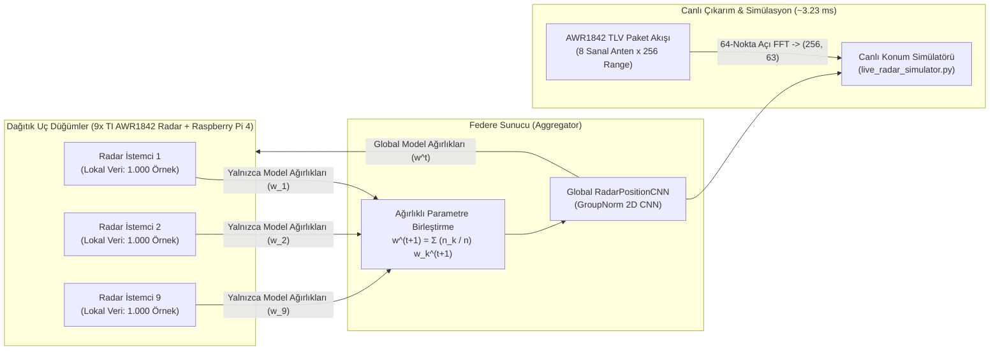
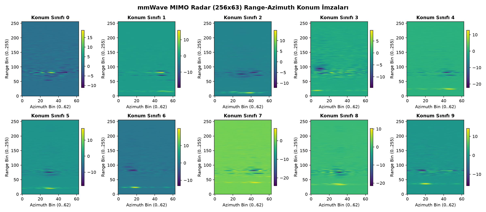
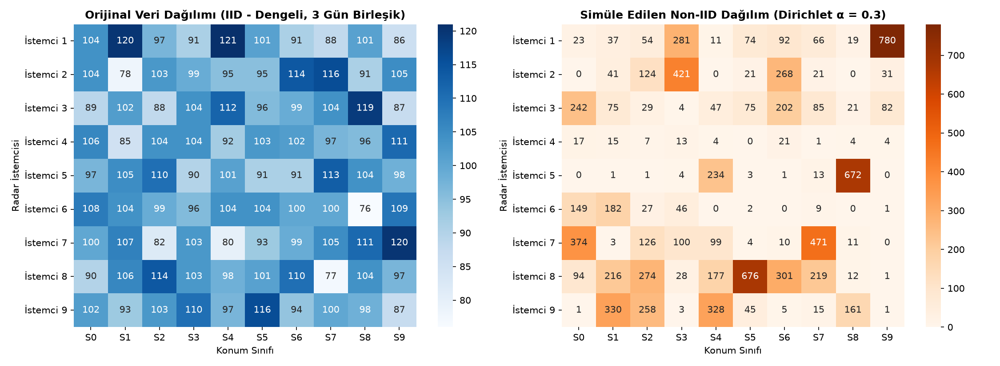
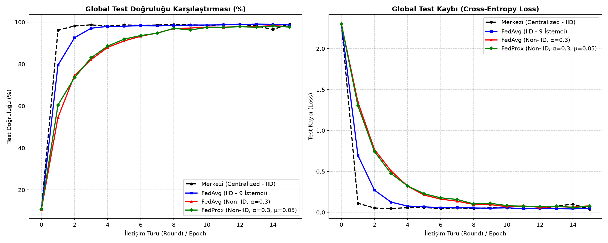
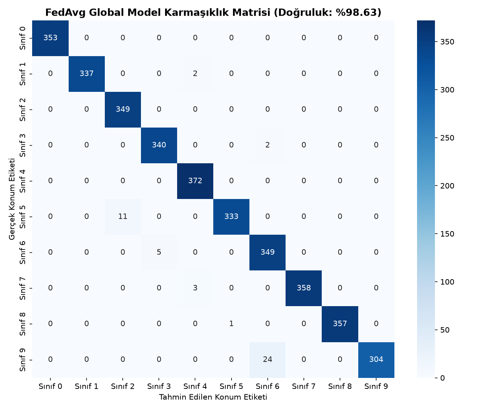
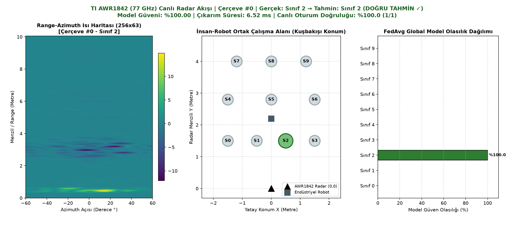

# Federated Radar Position Recognition
**Federated Learning for Privacy-Preserving Human Position & Activity Recognition using 77 GHz mmWave MIMO Radar**

[](https://www.python.org/)
[](https://pytorch.org/)
[]()
[]()

---

## İçindekiler
1. [Problemin Tanımı, Motivasyon ve Projenin Amacı](#1-problemin-tanımı-motivasyon-ve-projenin-amacı)
2. [mmWave FMCW MIMO Radar Sinyal İşleme ve Matematiksel Formülasyon](#2-mmwave-fmcw-mimo-radar-sinyal-işleme-ve-matematiksel-formülasyon)
3. [Veri Seti Mimarisi, Ön İşleme ve Non-IID (Dirichlet) Modellemesi](#3-veri-seti-mimarisi-ön-işleme-ve-non-iid-dirichlet-modellemesi)
4. [Derin Öğrenme (`RadarPositionCNN`) ve Federe Öğrenme (`FedAvg` & `FedProx`) Formülasyonu](#4-derin-öğrenme-radarpositioncnn-ve-federe-öğrenme-fedavg--fedprox-formülasyonu)
5. [Deneysel Sonuçlar, Karşılaştırmalar ve Performans Analizi](#5-deneysel-sonuçlar-karşılaştırmalar-ve-performans-analizi)
6. [Canlı Radar Konum Tanıma Simülatörü (Native Masaüstü GUI)](#6-canlı-radar-konum-tanıma-simülatörü-native-masaüstü-gui)
7. [Proje Klasör Yapısı ve Kurulum / Çalıştırma Kılavuzu](#7-proje-klasör-yapısı-ve-kurulum--çalıştırma-kılavuzu)

---

## 1. Problemin Tanımı, Motivasyon ve Projenin Amacı

### 1.1. Problemin Tanımı ve Gerekçe
Endüstriyel **İnsan-Robot Ortak Çalışma Alanlarında (Human-Robot Collaborative Workspaces - HRC)**, akıllı fabrikalarda, yaşlı bakım tesislerinde ve akıllı binalarda insan konumunun gerçek zamanlı ve yüksek hassasiyetle tespit edilmesi iş güvenliği ve otomasyon için zorunludur. Ancak mevcut geleneksel yaklaşımlar iki temel darboğazla karşılaşmaktadır:

1. **Sensör Mahremiyeti ve Çevresel Kısıtlar**: Kamera (RGB/Derinlik) tabanlı optik sistemler, çalışanların veya bireylerin görsel kimliklerini kaydettiği için ciddi mahremiyet (KVKK / GDPR) endişelerine yol açar; ayrıca karanlık, duman, buhar ve toz altında performansları düşer. **77 GHz mmWave MIMO Radar** ise optik görüntü kaydetmeden, elektromanyetik dalga yansımalarıyla her türlü ışık ve ortam koşulunda milimetrik hareket ve konum algılama yeteneği sunar.
2. **Merkezi Veri Toplamanın Gizlilik ve Bant Genişliği Maliyeti**: Geleneksel makine öğrenimi yaklaşımları, ortamda bulunan tüm radar düğümlerinin yüksek boyutlu ham menzil-açı (Range-Azimuth) ısı haritalarını merkezi bir sunucuya göndermesini gerektirir. Sürekli akan radar matrisleri hem ağ bant genişliğini tüketir hem de merkezi sunucuda kişilerin mekan içi hareket izlerinin (davranışsal biyometri) depolanması nedeniyle gizlilik riski oluşturur.

### 1.2. Projenin Amacı
Bu projenin temel amacı; çalışma alanına dağıtılmış **9 adet Texas Instruments AWR1842 (77 GHz, 2Tx-4Rx) mmWave MIMO radar** istemcisinden elde edilen `(256, 63)` boyutlu Range-Azimuth ısı haritalarını, **ham verileri hiçbir zaman sensör düğümünden (Raspberry Pi / Edge cihazdan) dışarı çıkarmadan** **Federe Öğrenme (Federated Learning - `FedAvg` ve `FedProx`)** ile eğitmek ve 10 farklı çalışma alanı konum bölgesini (**Sınıf 0..9**) gerçek zamanlı (~3.2 ms) olarak sınıflandırmaktır.



---

## 2. mmWave FMCW MIMO Radar Sinyal İşleme ve Matematiksel Formülasyon

Sistemde kullanılan **Texas Instruments AWR1842** radar sensörü, **FMCW (Frequency Modulated Continuous Wave - Frekans Modülasyonlu Sürekli Dalga)** prensibiyle çalışır (`profile_usb2x4_working_fps4_doppler+heat.cfg`).

### 2.1. FMCW Chirp Sinyali ve Menzil (Range) Çözünürlüğü
Radar vericisi, başlangıç frekansı $f_0 = 77\text{ GHz}$ ve frekans artış eğimi $S = \frac{B}{T_c} = 70\text{ MHz}/\mu\text{s}$ olan doğrusal frekans modülasyonlu bir *chirp* sinyali gönderir. $R$ mesafesindeki bir hedeften yansıyan sinyal, $\tau = \frac{2R}{c}$ gecikmeyle alıcıya ulaşır ve karıştırıcıdan (mixer) geçirilerek **vuru frekansı (beat frequency - $f_b$)** üretilir:

$$f_b = S \cdot \tau = \frac{2 \cdot S \cdot R}{c}$$

Burada $c = 3 \times 10^8\text{ m/s}$ ışık hızıdır. Hızlı-zaman (fast-time) ADC örnekleri ($N_{\text{ADC}} = 256$, örnekleme hızı $F_s = 5209\text{ ksps}$) üzerinde uygulanan **1D Menzil FFT'si (Range FFT)** ile frekans bileşenleri menzil hücrelerine (Range Bins) dönüştürülür:

$$\Delta R = \frac{c}{2 B} = \frac{c \cdot F_s}{2 \cdot S \cdot N_{\text{ADC}}} = \frac{3 \times 10^8 \times 5209 \times 10^3}{2 \times (70 \times 10^{12}) \times 256} = 0.0436\text{ m } (4.36\text{ cm})$$

$$\text{Maksimum Menzil } (R_{\max}) = \frac{0.9 \cdot c \cdot F_s}{2 \cdot S} = 10.05\text{ m}$$

### 2.2. Radyal Doppler Hızı Formülasyonu
Bir çerçeve (frame) içinde ardışık gönderilen chirp'ler arasındaki faz değişimi $\Delta \phi = \frac{4 \pi v T_c}{\lambda}$ üzerinden **Doppler FFT** uygulanarak hedefin radyal hızı ($v$) hesaplanır ($N_{\text{Doppler}} = 16$, $T_c = T_{\text{idle}} + T_{\text{ramp}} = 486.14\,\mu\text{s}$):

$$\Delta v = \frac{\lambda}{2 \cdot N_{\text{Doppler}} \cdot N_{Tx} \cdot T_c} = 0.1252\text{ m/s}, \qquad v_{\max} = \frac{\lambda}{4 \cdot N_{Tx} \cdot T_c} = 1.00\text{ m/s}$$

### 2.3. MIMO Sanal Anten Dizisi ve Range-Azimuth `(256, 63)` Isı Haritası Üretimi
AWR1842 üzerinde $N_{Tx} = 2$ verici ve $N_{Rx} = 4$ alıcı anten bulunur. Zaman Bölmeli Çoğullama (TDM-MIMO) ile $N_V = N_{Tx} \times N_{Rx} = 8$ elemanlı doğrusal bir **Sanal Anten Dizisi (Virtual Uniform Linear Array - ULA)** oluşturulur.

Geliş açısı (Angle of Arrival - AoA) $\theta$ olan bir hedef sinyali, ardışık sanal antenler ($d = \lambda / 2$ aralıklı) arasında $\omega = \frac{2\pi d \sin\theta}{\lambda} = \pi \sin\theta$ uzamsal faz farkı yaratır. Radarın seri port üzerinden gönderdiği `MMWDEMO_OUTPUT_MSG_AZIMUT_STATIC_HEAT_MAP` (TLV Tipi 4) paketi, her bir menzil hücresi $r \in \{0, \dots, 255\}$ ve sanal anten $m \in \{0, \dots, 7\}$ için karmaşık temel-bant (complex I/Q) değerlerini $\mathbf{X}(m, r) \in \mathbb{C}^{8 \times 256}$ içerir.

Bu matrisin anten ekseni boyunca $N_{\text{angle}} = 64$ noktalı sıfır-dolgulu (zero-padded) **Açı FFT'si (Angle FFT)** alınır ve sıfır frekansı merkeze kaydırılır (`fftshift`):

$$\mathbf{Q}(k, r) = \text{fftshift}\left( \left| \sum_{m=0}^{N_V - 1} \mathbf{X}(m, r) \, e^{-j \frac{2\pi}{N_{\text{angle}}} m k} \right| \right), \quad k \in \{0, \dots, 63\}$$

Açı hücrelerine karşılık gelen fiziksel azimuth açıları ($\theta_k$):

$$\theta_k = \arcsin\left( \frac{2 k}{N_{\text{angle}}} \right), \quad k \in \left[ -\frac{N_{\text{angle}}}{2}+1, \, \frac{N_{\text{angle}}}{2}-1 \right]$$

Son adımda $\mathbf{Q}$ matrisinin transpozu alınır ($256 \times 64$), sınır biti olan ilk sütun çıkarılır ($256 \times 63$) ve yatay eksende aynalanarak (`fliplr`) derin öğrenme modelinin giriş tensörü olan **Range-Azimuth Isı Haritası** $\mathbf{H} \in \mathbb{R}^{256 \times 63}$ elde edilir (`src/awr1842_bridge.py`).

### 2.4. Donanım Parametreleri Özeti

| Fiziksel Parametre | Sembol | Değer | Birim |
| :--- | :---: | :---: | :---: |
| Başlangıç Frekansı | $f_0$ | $77.0$ | $\text{GHz}$ |
| Sanal Anten Dizisi ($N_{Tx} \times N_{Rx}$) | $N_V$ | $2 \times 4 = 8$ | Sanal Kanal |
| Chirp Frekans Eğimi | $S$ | $70.0$ | $\text{MHz}/\mu\text{s}$ |
| Menzil FFT Boyutu (Range Bins) | $N_{\text{range}}$ | $256$ | Hücre (Bin) |
| Azimuth Açı Hücresi (Angle Bins) | $N_{\text{azimuth}}$ | $63$ ($64 - 1$) | Hücre (Bin) |
| Doppler FFT Boyutu | $N_{\text{Doppler}}$ | $16$ | Hücre (Bin) |
| Menzil Çözünürlüğü | $\Delta R$ | $0.0436$ ($4.36\text{ cm}$) | $\text{m}$ |
| Maksimum Çalışma Menzili | $R_{\max}$ | $10.05$ | $\text{m}$ |
| Radyal Hız Çözünürlüğü / Maks. Hız | $\Delta v \;/\; v_{\max}$ | $0.1252 \;/\; 1.00$ | $\text{m/s}$ |



---

## 3. Veri Seti Mimarisi, Ön İşleme ve Non-IID (Dirichlet) Modellemesi

### 3.1. Çok Günlü (`day0`, `day1`, `day2`) Dağıtık Radar Veri Seti
Veri seti, 3 farklı günde **9 bağımsız radar istemcisinden (Client 1..9)** toplanan `.mat` dosyalarından oluşur:

| Gün | İstemci Sayısı | İstemci Başına Eğitim Örneği | Toplam Eğitim Örneği | Global Test Örneği | Giriş Tensör Boyutu | Etiket Aralığı |
| :--- | :---: | :---: | :---: | :---: | :---: | :---: |
| **`day0`** | 9 | 500 | 4.500 | 1.500 | `(N, 1, 256, 63)` | `0..9` (10 Sınıf) |
| **`day1`** | 9 | 250 | 2.250 | 1.000 | `(N, 1, 256, 63)` | `0..9` (10 Sınıf) |
| **`day2`** | 9 | 250 | 2.250 | 1.000 | `(N, 1, 256, 63)` | `0..9` (10 Sınıf) |
| **TOPLAM** | **9 İstemci** | **1.000 / İstemci** | **9.000** | **3.500** | `(N, 1, 256, 63)` | **10 Konum Bölgesi** |

### 3.2. Giderilen `uint8` Etiket Taşması (Underflow) Hatası ve Örnek Bazlı Z-Score Normalizasyonu
1. **`uint8` Underflow Düzeltmesi**: Ham `.mat` dosyalarındaki etiket vektörleri (`label_train_1..9` ve `label_test`), $y \in \{0, 1, \dots, 9\}$ değerlerini **işaretsiz 8-bit tamsayı (`uint8`)** olarak tutmaktadır. Orijinal prototipte yer alan `labels.flatten() - 1` işlemi, `0` etiketinden `1` çıkarıldığında `uint8` taşmasına (underflow) uğrayarak $0 - 1 \equiv 255 \pmod{256}$ değerini üretmekte ve çapraz entropi kayıp fonksiyonunun çökmesine neden olmaktaydı. `src/dataset.py` içinde etiketler güvenli biçimde `int64` tipine dönüştürülerek bu sorun giderilmiştir.
2. **Örnek Bazlı (Per-Sample) Z-Score Standardizasyonu**: Farklı günlerdeki (`day0` min/max: $[-34201, +75857]$ iken `day2` min/max: $[-23372, +57049]$) ortam yansıması ve kalibrasyon kaymalarını (domain shift) gidermek için her bir radar çerçevesi $\mathbf{H}_i \in \mathbb{R}^{256 \times 63}$ kendi uzamsal ortalaması ($\mu_i$) ve standart sapması ($\sigma_i$) ile normalize edilir:

$$\mu_i = \frac{1}{256 \times 63} \sum_{r=1}^{256} \sum_{a=1}^{63} \mathbf{H}_i(r, a), \qquad \sigma_i = \sqrt{\frac{1}{256 \times 63} \sum_{r=1}^{256} \sum_{a=1}^{63} \left(\mathbf{H}_i(r, a) - \mu_i\right)^2}$$

$$\tilde{\mathbf{H}}_i(r, a) = \frac{\mathbf{H}_i(r, a) - \mu_i}{\sigma_i + \epsilon}, \quad (\epsilon = 10^{-8})$$

### 3.3. Dirichlet Dağılımı ile Non-IID Veri Heterojenliği Modellemesi
Gerçek endüstriyel ortamlarda her radar düğümü her konum bölgesini eşit sıklıkta gözlemleyemez (Non-IID - *Non-Independent and Identically Distributed*). Bu durumu matematiksel olarak simüle etmek için her $c \in \{0, \dots, 9\}$ sınıfının örnekleri, $K = 9$ istemci arasında **simetrik Dirichlet dağılımından** çekilen oran vektörü $\mathbf{p}_c = (p_{c,1}, \dots, p_{c,K}) \sim \text{Dir}(\alpha \cdot \mathbf{1}_K)$ kullanılarak paylaştırılmıştır:

$$f(p_{c,1}, \dots, p_{c,K}; \alpha) = \frac{\Gamma(K\alpha)}{\Gamma(\alpha)^K} \prod_{k=1}^{K} p_{c,k}^{\alpha - 1}, \quad \sum_{k=1}^{K} p_{c,k} = 1$$

Yoğunluk parametresi **$\alpha = 0.3$** seçilerek bazı istemcilerin belirli sınıflarda yoğunlaştığı, bazı sınıflara ise neredeyse hiç sahip olmadığı gerçekçi bir **Non-IID** senaryo üretilmiştir.



---

## 4. Derin Öğrenme (`RadarPositionCNN`) ve Federe Öğrenme (`FedAvg` & `FedProx`) Formülasyonu

### 4.1. Neden BatchNorm Yerine GroupNorm? (`RadarPositionCNN`)
Standart Konvolüsyonel Sinir Ağlarında kullanılan `BatchNormalization`, her kanal için yığın (mini-batch) üzerinden hareketli ortalama ($\hat{\mu}_B$) ve varyans ($\hat{\sigma}_B^2$) tutar. Ancak **Non-IID Federated Learning** senaryolarında her istemcinin veri dağılımı farklı olduğundan, lokal `BatchNorm` istatistikleri birbirinden sapar (*statistic divergence / client drift*) ve sunucuda ağırlık ortalaması alındığında global modelin doğruluğu düşer.

Bu projede geliştirilen **`RadarPositionCNN`** (`src/models.py`), yığın boyutundan ve istemci sınıf dağılımından bağımsız olarak her örneğin kendi kanal grupları ($G$) içinde normalizasyon yapan **Group Normalization (`GroupNorm`)** katmanlarını kullanır:

| Katman / Blok | İşlem ve Hiperparametreler | Çıkış Boyutu $(C \times H \times W)$ |
| :--- | :--- | :---: |
| **Giriş** | Normalize Range-Azimuth Radar Çerçevesi | $1 \times 256 \times 63$ |
| **Blok 1** | `Conv2d(1→24, k=3x3, s=2, p=1)` + `GroupNorm(G=4, C=24)` + `ReLU` + `MaxPool2d(2x2)` | $24 \times 64 \times 16$ |
| **Blok 2** | `Conv2d(24→48, k=3x3, s=2, p=1)` + `GroupNorm(G=8, C=48)` + `ReLU` + `MaxPool2d(2x2)` | $48 \times 16 \times 4$ |
| **Blok 3** | `Conv2d(48→96, k=3x3, s=1, p=1)` + `GroupNorm(G=8, C=96)` + `ReLU` + `AdaptiveAvgPool2d(4x2)` | $96 \times 4 \times 2$ |
| **Sınıflandırıcı** | `Flatten(768)` + `Linear(768→160)` + `ReLU` + `Dropout(p=0.3)` + `Linear(160→10)` | $10$ (Logits) |

### 4.2. Federated Averaging (`FedAvg`) Algoritması
Toplam $K = 9$ istemcinin bulunduğu sistemde, $k$-ıncı istemcinin lokal veri kümesi $\mathcal{D}_k$ ($n_k = |\mathcal{D}_k|$) ve toplam örnek sayısı $n = \sum_{k=1}^{K} n_k$ olsun. Global amaç fonksiyonu:

$$\min_{w \in \mathbb{R}^d} \; F(w) = \sum_{k=1}^{K} \frac{n_k}{n} F_k(w), \qquad F_k(w) = \frac{1}{n_k} \sum_{(x_i, y_i) \in \mathcal{D}_k} \mathcal{L}_{\text{CE}}(w; x_i, y_i)$$

Her iletişim turunda ($t = 1, \dots, T$):
1. **Yayılım (Broadcast)**: Sunucu mevcut global model ağırlıklarını $w^{(t)}$ istemcilere gönderir.
2. **Lokal Eğitim (Client Update)**: Her istemci $k$, $w_k^{(t, 0)} \leftarrow w^{(t)}$ ile başlayarak kendi verisi $\mathcal{D}_k$ üzerinde $E = 2$ lokal epoch boyunca mini-batch ($\mathcal{B}$) gradyan inişi (Adam optimizer, $\eta = 10^{-3}$) uygular:
   $$w_k^{(t, \tau+1)} = w_k^{(t, \tau)} - \eta \nabla F_k\left(w_k^{(t, \tau)}; \mathcal{B}\right)$$
3. **Ağırlıklı Birleştirme (Server Aggregation)**: Sunucu, istemcilerden yalnızca güncellenmiş ağırlıkları $w_k^{(t+1)}$ alır ve örnek sayısı ağırlıklı ortalamayla yeni global modeli oluşturur:
   $$w^{(t+1)} = \sum_{k=1}^{K} \frac{n_k}{n} w_k^{(t+1)}$$

### 4.3. `FedProx` Algoritması (Non-IID İstemci Sapmasını Önleme)
Non-IID veri dağılımında lokal modellerin birbirinden aşırı uzaklaşmasını (*client drift*) sınırlandırmak için **FedProx**, her istemcinin lokal kayıp fonksiyonuna global ağırlıklara ($w^{(t)}$) olan Öklid uzaklığını cezalandıran **proksimal bir terim ($\frac{\mu}{2} \|w - w^{(t)}\|_2^2$)** ekler (`src/fl_engine.py`, $\mu = 0.05$):

$$\min_{w} \; h_k\left(w; w^{(t)}\right) = F_k(w) + \frac{\mu}{2} \left\| w - w^{(t)} \right\|_2^2$$

Lokal gradyan güncellemesi:

$$\nabla h_k\left(w; w^{(t)}\right) = \nabla F_k(w) + \mu \left( w - w^{(t)} \right)$$

---

## 5. Deneysel Sonuçlar, Karşılaştırmalar ve Performans Analizi

Tüm deneyler 3 günün birleşik veri seti (**9.000 eğitim örneği, 3.500 global test örneği**) üzerinde `NUM_ROUNDS = 15`, `LOCAL_EPOCHS = 2`, `BATCH_SIZE = 64` ve `lr = 0.001` parametreleriyle çalıştırılmıştır.

### 5.1. Algoritma Karşılaştırma Tablosu (Centralized vs. FedAvg vs. FedProx)

| Algoritma / Senaryo | Veri Dağılımı | Veri Gizliliği | 1. Tur Test Doğruluğu | 6. Tur Test Doğruluğu | Tepe (Peak) Test Doğruluğu | 15. Tur Nihai Doğruluk | En Düşük Test Kaybı |
| :--- | :--- | :---: | :---: | :---: | :---: | :---: | :---: |
| **Centralized (Merkezi Referans)** | Tüm Veri Sunucuda (IID) | Yok | %96.17 | %98.43 | **%99.11** | **%99.11** | 0.0377 |
| **FedAvg (9 İstemci)** | Dengeli (IID) | **Tam** | %79.49 | %98.31 | **%98.94** (Tur 14) | **%98.63** | 0.0419 |
| **FedAvg (9 İstemci)** | Heterojen (**Non-IID**, $\alpha=0.3$) | **Tam** | %54.57 | %93.26 | **%98.29** (Tur 14) | **%97.91** | 0.0617 |
| **FedProx (9 İstemci, $\mu=0.05$)** | Heterojen (**Non-IID**, $\alpha=0.3$) | **Tam** | **%60.49** (+%5.92) | **%93.60** | **%98.17** (Tur 14) | **%97.63** | 0.0606 |



### 5.2. Sınıf Bazlı Sınıflandırma Raporu (3.500 Test Örneği - FedAvg Global Model)

$$\text{Precision}_c = \frac{TP_c}{TP_c + FP_c}, \qquad \text{Recall}_c = \frac{TP_c}{TP_c + FN_c}, \qquad \text{F1-Score}_c = \frac{2 \cdot \text{Precision}_c \cdot \text{Recall}_c}{\text{Precision}_c + \text{Recall}_c}$$

| Konum Sınıfı (Çalışma Alanı Bölgesi) | Precision (Kesinlik) | Recall (Duyarlılık) | F1-Score | Test Örnek Sayısı (Support) |
| :--- | :---: | :---: | :---: | :---: |
| **Sınıf 0** (Bölge 0 - Sol Yakın) | 1.0000 | 1.0000 | **1.0000** | 353 |
| **Sınıf 1** (Bölge 1 - Orta-Sol Yakın) | 1.0000 | 0.9941 | **0.9970** | 339 |
| **Sınıf 2** (Bölge 2 - Orta-Sağ Yakın) | 0.9694 | 1.0000 | **0.9845** | 349 |
| **Sınıf 3** (Bölge 3 - Sağ Yakın) | 0.9855 | 0.9942 | **0.9898** | 342 |
| **Sınıf 4** (Bölge 4 - Sol Orta) | 0.9867 | 1.0000 | **0.9933** | 372 |
| **Sınıf 5** (Bölge 5 - Merkez / Robot Yanı) | 0.9970 | 0.9680 | **0.9823** | 344 |
| **Sınıf 6** (Bölge 6 - Sağ Orta) | 0.9307 | 0.9859 | **0.9575** | 354 |
| **Sınıf 7** (Bölge 7 - Sol Uzak) | 1.0000 | 0.9917 | **0.9958** | 361 |
| **Sınıf 8** (Bölge 8 - Merkez Uzak) | 1.0000 | 0.9972 | **0.9986** | 358 |
| **Sınıf 9** (Bölge 9 - Sağ Uzak) | 1.0000 | 0.9268 | **0.9620** | 328 |
| **Macro Ortalama / Toplam** | **0.9869** | **0.9858** | **0.9861** | **3.500 (Genel Doğruluk: %98.63)** |

### 5.3. Gün Bazlı Test Doğrulukları
- **`day0` Test Kümesi (1.500 örnek)**: **%99.93**
- **`day1` Test Kümesi (1.000 örnek)**: **%97.40**
- **`day2` Test Kümesi (1.000 örnek)**: **%97.90**



---

## 6. Canlı Radar Konum Tanıma Simülatörü (Native Masaüstü GUI)

Eğitilmiş `FedAvg` global modelini (`results/best_global_radar_cnn.pt`) gerçek radar çerçeveleri üzerinde canlı olarak test etmek için Tkinter tabanlı bağımsız masaüstü simülatörü (`live_radar_simulator.py`) geliştirilmiştir:

- **Sol Panel**: `(256, 63)` boyutlu Range-Azimuth radar ısı haritası ($-60^\circ \dots +60^\circ$ Azimuth açısı ve $0 \dots 10.05\text{ m}$ menzil).
- **Orta Panel**: İnsan-Robot ortak çalışma alanının 2D kuşbakışı Kartezyen haritası üzerinde AWR1842 radarın $(0,0)$, endüstriyel robotun $(0, 2.2\text{ m})$, gerçek insan konumunun ve tahmin edilen konumun gerçek zamanlı gösterimi.
- **Sağ Panel**: 10 konum sınıfı için anlık Softmax olasılık dağılımı ve çerçeve başına çıkarım süresi (**3.23 ms**).
- **Canlı Kontroller**: `▶ Sonraki Radar Çerçevesi` (`Space`), `⟳ Canlı Radar Akışını Başlat` (`S`), `Konum Sınıfı Filtresi (Sınıf 0..9)` ve `Akış Hızı (400ms / 800ms / 1500ms)`.



---

## 7. Proje Klasör Yapısı ve Kurulum / Çalıştırma Kılavuzu

```text
Federated_Radar_Position_Recognition-main/
├── src/
│   ├── __init__.py
│   ├── dataset.py          # 3 günlük .mat veri yükleyici, Z-score normalizasyon, Dirichlet Non-IID bölümleyici
│   ├── models.py           # GroupNorm tabanlı 2D CNN (RadarPositionCNN)
│   ├── fl_engine.py        # FedAvg, FedProx ve Centralized eğitim & değerlendirme motoru
│   └── awr1842_bridge.py   # TI AWR1842 .cfg ayrıştırıcı, TLV -> (256, 63) FFT dönüştürücü ve gerçek zamanlı tahmin
├── results/
│   ├── best_global_radar_cnn.pt          # Eğitilmiş en iyi Global Model ağırlıkları
│   ├── experiment_summary.json           # Tüm deneylerin sayısal metrikleri ve sınıflandırma raporu
│   ├── radar_range_azimuth_samples.png   # 10 konum sınıfına ait örnek Range-Azimuth radar imzaları
│   ├── iid_vs_non_iid_distribution.png   # IID ve Non-IID (Dirichlet alpha=0.3) istemci veri dağılımları
│   ├── training_curves_comparison.png    # Centralized vs FedAvg vs FedProx doğruluk ve kayıp eğrileri
│   ├── confusion_matrix_fedavg.png       # 3.500 test örneği üzerinde nihai Karmaşıklık Matrisi
│   └── live_simulator_preview.png        # Canlı radar konum simülatörü arayüz önizlemesi
├── 01_Attention_Cosine_Augmentation/     # [Geliştirme 1] Coordinate Attention ResNet + Fiziksel Gürültü + CosineLR (%99.03)
├── 02_FedAvgM_Server_Momentum/           # [Geliştirme 2] Sunucu Momentumu (FedAvgM, beta=0.6) Non-IID Analizi (%98.60)
├── 03_Differential_Privacy_DP_FedAvg/    # [Geliştirme 3] (epsilon, delta)-Diferansiyel Gizlilik (DP-FedAvg) Analizi
├── 04_Byzantine_Robust_Aggregation/      # [Geliştirme 4] 2/9 Saldırgan Sensör Altında Median & Trimmed-Mean (%98.69)
├── train_and_evaluate.py                 # Tek komutla ana deneyleri çalıştıran ve grafikleri üreten betik
├── live_radar_simulator.py               # Canlı Range-Azimuth & 2D çalışma alanı konum tanıma simülatörü (Native Tkinter GUI)
├── PROJE_RAPORU.md                       # Ana sistemin teorik formüllerini, tanımlarını ve sonuçlarını içeren rapor
├── NIHAI_KAPSAMLI_RAPOR.md               # Ana sistem + 4 ileri seviye geliştirmenin birleşik nihai raporu
├── requirements.txt                      # Python paket bağımlılıkları
├── Federated_Radar_Position_Recognition.ipynb  # Çıktıları ve görselleri gömülü güncel Jupyter Notebook
└── README.md
```

### Kurulum ve Çalıştırma Komutları

```bash
# 1. Bağımlılıkları yükleyin
pip install -r requirements.txt

# 2. Tüm Federated Learning (Centralized, FedAvg-IID, FedAvg-NonIID, FedProx-NonIID) deneylerini çalıştırın
python train_and_evaluate.py

# 3. Canlı İnteraktif Radar Konum Tanıma Simülatörünü (Masaüstü GUI) başlatın
python live_radar_simulator.py
```

Tüm teorik türetmeler, matematiksel formüller, algoritma sözde-kodları (pseudocode) ve detaylı analizler için [PROJE_RAPORU.md](PROJE_RAPORU.md) dosyasını inceleyebilirsiniz.
